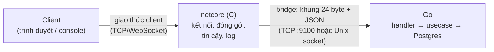

# Giao thức bridge: netcore (C) ⇄ server nghiệp vụ (Go)

> Đặc tả **đường nội bộ** giữa `netcore` (tầng mạng bằng C) và `backend` (Go). Đây **không phải** giao thức client ↔ netcore (header 24 byte có CRC/seq/ack ở [KIEN-TRUC-MANG-C-GO.md](KIEN-TRUC-MANG-C-GO.md) mục 3 — sẽ có `PROTOCOL.md` riêng). Đường nội bộ chạy trên máy cục bộ, tin cậy, nên không cần CRC/ack/retry: netcore đã lo các việc đó với client rồi mới chuyển yêu cầu sang đây.

Mã nguồn tương ứng:

| Thành phần | Go | C |
|---|---|---|
| Khung, đọc/ghi, mã loại | [protocol.go](../backend/internal/infra/bridge/protocol.go), [types.go](../backend/internal/infra/bridge/types.go) | [bridge.h](../backend/netcore/include/bridge.h), [bridge.c](../backend/netcore/src/bridge/bridge.c) |
| Server, định tuyến, phiên, push | [server.go](../backend/internal/infra/bridge/server.go), [router.go](../backend/internal/infra/bridge/router.go), [session.go](../backend/internal/infra/bridge/session.go) | — (netcore dùng thư viện `bridge`) |
| Handler nghiệp vụ | [handlers/](../backend/internal/infra/bridge/handlers/) | — |
| Client thử | — | [bridge_cli.c](../backend/netcore/tools/bridge_cli.c) |

## 1. Vai trò



- **netcore là bên chủ động kết nối** tới Go (Go lắng nghe, mặc định `:9100`). Thường chỉ một kết nối bridge; nhiều kết nối vẫn được hỗ trợ (ví dụ netcore khởi động lại).
- netcore gán cho mỗi client một **`conn_id`** (u32, khác 0) và chuyển yêu cầu của client đó thành khung `REQUEST`.
- **Go không biết gì về TCP/WebSocket của client.** Go chỉ thấy `conn_id`. Go tự nhớ `conn_id` nào đã đăng nhập là ai (`Session`), nên khi cần đẩy thông báo cho một người dùng, Go tự tìm các `conn_id` của họ rồi gửi `PUSH` với từng `conn_id`. netcore không cần biết user.

## 2. Khung (frame)

Mỗi thông điệp = **header 24 byte** + **payload** (JSON UTF-8, `length` byte). Số nguyên **big-endian** (byte cao trước).

| Offset | Size | Trường | Ý nghĩa |
|---:|---:|---|---|
| 0 | 2 | `magic` | `0x4C54` ("LT"). Sai magic → bên nhận đóng kết nối |
| 2 | 1 | `version` | `1`. Khác → đóng kết nối |
| 3 | 1 | `kind` | vai trò khung (mục 3) |
| 4 | 2 | `type` | loại thông điệp nghiệp vụ (mục 4) |
| 6 | 2 | `status` | mã kết quả (mục 5); chỉ có nghĩa trong `RESPONSE`, còn lại là 0 |
| 8 | 4 | `conn_id` | kết nối của client phía netcore |
| 12 | 8 | `req_id` | số yêu cầu do netcore sinh; `RESPONSE` trả lại đúng giá trị này |
| 20 | 4 | `length` | số byte payload, tối đa `1 MiB` (1 048 576) |

Ví dụ header của `REQUEST AUTH_LOGIN`, `conn_id=7`, `req_id=0x0102030405060708`, payload 33 byte:

```
4C 54 | 01 | 01 | 01 02 | 00 00 | 00 00 00 07 | 01 02 03 04 05 06 07 08 | 00 00 00 21
magic  ver  kind   type   status      conn_id              req_id               length
```

Chuỗi byte này có trong cả hai bộ test (Go: `TestEncodeDecodeRoundTrip`; C: `make test`) để bảo đảm hai bên hiểu header giống nhau.

**Đọc khung từ luồng TCP** (TCP không giữ ranh giới thông điệp): đọc đủ 24 byte → kiểm tra magic/version/length → đọc đủ `length` byte. Mỗi lần `recv()` có thể trả về ít hơn yêu cầu hoặc nhiều khung dính nhau, nên phải lặp đến khi đủ. Cả hai phía đã được test với dữ liệu đến từng byte một.

## 3. Loại khung (`kind`)

| Giá trị | Tên | Hướng | Mô tả |
|---:|---|---|---|
| 1 | `REQUEST` | C → Go | Yêu cầu nghiệp vụ của một client. Có `type`, `conn_id`, `req_id`, payload JSON |
| 2 | `RESPONSE` | Go → C | Phản hồi cho một `REQUEST`; giữ nguyên `type`, `conn_id`, `req_id`; `status` cho biết kết quả |
| 3 | `PUSH` | Go → C | Tin đẩy chủ động (thông báo trễ chuyến...). `conn_id` = kết nối đích; **`conn_id = 0` = gửi cho mọi kết nối**. Không có `req_id` |
| 4 | `CONN_OPEN` | C → Go | Có client mới. Payload `{"remote":"1.2.3.4:5555","transport":"tcp"\|"ws"}` |
| 5 | `CONN_CLOSE` | C → Go | Client đã ngắt; Go xoá phiên của `conn_id` đó |
| 6 | `PING` | hai chiều | Kiểm tra đường nội bộ còn sống |
| 7 | `PONG` | hai chiều | Trả lời `PING`, giữ nguyên `req_id` và payload |
| 8 | `KICK` | Go → C | Yêu cầu netcore đóng kết nối `conn_id` |

Quy tắc:
- Go chấp nhận `REQUEST` của một `conn_id` chưa từng `CONN_OPEN` (tự tạo phiên) để chịu lỗi tốt hơn, nhưng netcore nên luôn gửi `CONN_OPEN` trước.
- Các `REQUEST` được Go xử lý **song song** (tối đa 64 yêu cầu đồng thời mỗi đường nội bộ) nên **thứ tự phản hồi có thể khác thứ tự yêu cầu** — hãy ghép bằng `req_id`.
- Khung có `kind` lạ bị Go bỏ qua (ghi log), không đóng kết nối.

## 4. Loại thông điệp (`type`)

Đang triển khai (giai đoạn 3):

| Mã | Tên | Đăng nhập | Payload yêu cầu | Phản hồi thành công |
|---:|---|---|---|---|
| `0x0001` | `SYS_HEALTH` | không | `{}` | `{status, version, cpuPercent, cpuCore}` |
| `0x0101` | `AUTH_REGISTER` | không | `{first_name, last_name, email, password}` (mật khẩu 6–72 ký tự) | `{message, user:{id, firstName, lastName, email}}` |
| `0x0102` | `AUTH_LOGIN` | không | `{email, password}` | `{token, user:{id, email, name, role}}` — kết nối được gắn danh tính |
| `0x0103` | `AUTH_LOGOUT` | có | `{}` | `{message}` — kết nối về lại là khách |
| `0x0104` | `AUTH_TOKEN` | không | `{token}` | `{userId, role}` — gắn danh tính cho kết nối mới bằng token đã có |
| `0x0201` | `FLIGHT_SEARCH` | không | `{departureCity, arrivalCity, flightDate}` (`flightDate`: `YYYY-MM-DD` hoặc RFC 3339) | `{message, data:[chuyến bay]}` |
| `0x0202` | `FLIGHT_GET` | không | `{flightId}` (số hoặc chuỗi) | thông tin một chuyến bay |
| `0x0203` | `FLIGHT_LIST` | không | `{page, limit}` (mặc định 1 và 10; `limit` tối đa 100) | `{message, data:[chuyến bay]}` |

Quy ước nhóm mã cho các giai đoạn sau (chưa triển khai): `0x01xx` xác thực, `0x02xx` chuyến bay, `0x03xx` đặt vé/giữ ghế, `0x04xx` thanh toán, `0x05xx` quản lý vé, `0x06xx` thông báo (push), `0x07xx` admin, `0x08xx` giám sát. Thêm loại mới: khai báo hằng ở [types.go](../backend/internal/infra/bridge/types.go) và [bridge.h](../backend/netcore/include/bridge.h), rồi `router.Handle(...)`.

## 5. Mã kết quả (`status` trong `RESPONSE`)

| Mã | Ý nghĩa | Ví dụ |
|---:|---|---|
| 0 | Thành công | |
| 400 | Dữ liệu yêu cầu sai | JSON hỏng, thiếu trường, ngày sai định dạng, email không hợp lệ |
| 401 | Chưa đăng nhập / sai thông tin | `AUTH_LOGIN` sai mật khẩu; gọi thông điệp cần đăng nhập khi còn là khách |
| 403 | Không đủ quyền | không phải admin |
| 404 | Không tìm thấy | chuyến bay không tồn tại; tìm kiếm không có kết quả |
| 409 | Xung đột | email đã đăng ký |
| 500 | Lỗi nội bộ | chi tiết **chỉ ghi vào log server**, client chỉ nhận `internal server error` |
| 501 | Loại thông điệp không biết | |
| 503 | Dịch vụ tạm không dùng được | (dành riêng) |
| 504 | Quá thời gian xử lý | handler chạy quá 15 giây |

Payload của phản hồi lỗi luôn là `{"message":"..."}`.

## 6. Phiên và đăng nhập

- Danh tính gắn theo **`conn_id`**, do Go giữ. Hai tab của cùng một người là hai `conn_id`, cùng `user_id`.
- `AUTH_LOGIN` hoặc `AUTH_TOKEN` thành công → từ đó các thông điệp cần đăng nhập trên `conn_id` đó chạy được. `AUTH_LOGOUT` hoặc `CONN_CLOSE` → xoá danh tính.
- Mất đường nội bộ (netcore khởi động lại) → Go xoá toàn bộ phiên của đường đó. Client dùng `AUTH_TOKEN` với token cũ để đăng nhập lại.
- Token là PASETO do `AUTH_LOGIN` trả về (hạn `ACCESS_TOKEN_DURATION`, mặc định 24 giờ).

## 7. Đẩy thông báo (PUSH)

Go gọi `server.PushToUser(userID, type, payload)` (đến mọi `conn_id` đang đăng nhập bằng `userID`, trả về số kết nối đã gửi; `0` = đang offline, thông báo vẫn nằm trong bảng `Notifications`) hoặc `server.Broadcast(type, payload)`. netcore nhận `PUSH`, tra `conn_id` rồi gửi tiếp cho client. Chưa có `PUSH` nghiệp vụ nào được dùng ở giai đoạn 3; cơ chế đã có test (`TestPushToUserAndBroadcast`).

## 8. Giới hạn và an toàn

| Hạng mục | Giá trị |
|---|---|
| Payload tối đa | 1 MiB (vượt → đóng đường nội bộ) |
| Yêu cầu xử lý song song | 64 mỗi đường nội bộ; đầy thì Go ngừng đọc, TCP tự dồn áp lực về netcore |
| Thời gian xử lý một yêu cầu | 15 giây (→ 504) |
| Thời gian ghi một khung | 10 giây (quá hạn → đóng đường nội bộ) |
| Panic trong handler | bị chặn, trả 500, server vẫn chạy |
| Log | mỗi khung vào/ra một dòng (`BRIDGE_LOG_PATH`, mặc định `logs/bridge.log`); khi `APP_ENV=development` ghi thêm payload đã **che** `password`, `token`, số thẻ, CCCD, hộ chiếu |

Ví dụ dòng log:

```
2026-11-10T15:55:21.646Z IN  conn=1 127.0.0.1:0 user=4 REQUEST AUTH_LOGIN req=20 50B payload={"email":"admin@qairlines.vn","password":"****"}
2026-11-10T15:55:21.654Z OUT conn=1 127.0.0.1:0 user=4 RESPONSE AUTH_LOGIN req=20 status=401 48B 8ms
```

## 9. Chạy và kiểm thử

```bash
# 1) Database: nạp schema + dữ liệu mẫu
psql -U postgres -d ltm -f backend/db/full_setup.sql

# 2) Server Go (đọc backend/.env hoặc biến môi trường; xem backend/.env.example)
cd backend && go run ./cmd/server          # lắng nghe BRIDGE_ADDRESS (mặc định :9100)

# 3) Client C thử đường nội bộ (Linux/WSL)
cd backend/netcore && make
./bin/bridge_cli                           # gõ "help"; ví dụ: login john.doe@example.com 123456

# 4) Test
cd backend && go test ./internal/infra/bridge/...     # giao thức, server, handler
cd backend/netcore && make test                       # header C trùng byte với Go
cd backend/netcore && ./tests/e2e_bridge.sh           # đầu cuối: C → Go → Postgres (cần bước 1–3)
```

Các ca đã được kiểm chứng đầu cuối, gồm khung gửi **từng byte một** (`slow`), khung rác (server đóng kết nối), loại thông điệp lạ (501), JSON hỏng (400), đăng ký trùng email (409), đăng nhập sai (401).
