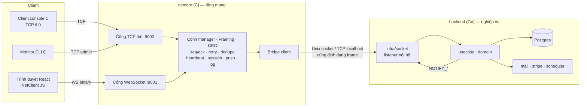
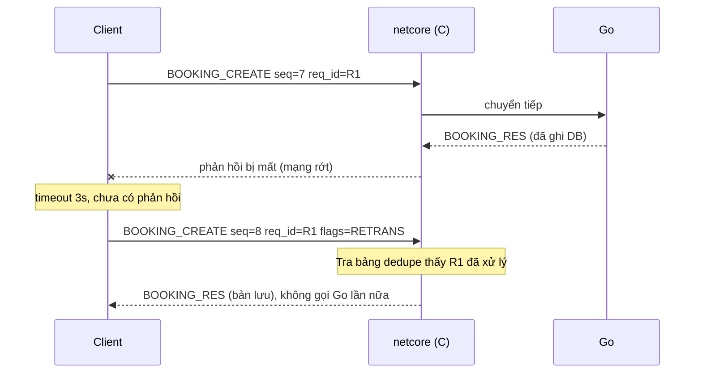

# Kiến trúc mạng: C (tầng mạng) + Go (nghiệp vụ)

> Tài liệu để **tự học và chuẩn bị bảo vệ**. Đây là bản đề xuất, chưa có code. Phần mạng bằng C do bạn tự viết; tài liệu này chỉ mô tả cần làm gì, theo thứ tự nào và kiểm tra ra sao.

---

## 1. Nguyên tắc chia việc

> **C quyết định mọi thứ về "gói tin đi như thế nào". Go quyết định mọi thứ về "gói tin có nghĩa gì".**

| | C (`netcore/`) | Go (`backend/`) |
|---|---|---|
| Kết nối | accept, quản lý nhiều client, timeout, heartbeat | không biết có bao nhiêu client |
| Đóng gói | tách gói từ luồng TCP, header, CRC, seq/ack | không đụng tới |
| Tin cậy | phát hiện lỗi, timeout, gửi lại, chống xử lý trùng, nối lại phiên | chỉ cần idempotent làm lớp bảo vệ cuối |
| WebSocket | tự bắt tay (SHA-1/Base64), tự đọc/ghi frame | không biết |
| Đẩy tin | biết user nào đang ở kết nối nào, gửi push, giữ hàng đợi chưa ack | quyết định *gửi gì cho ai* (trễ chuyến, vé...) |
| Log | ghi **từng gói** vào/ra, kèm trạng thái CRC/seq | log nghiệp vụ |
| Nghiệp vụ | **không** hiểu JSON, chỉ chuyển tiếp | usecase, Postgres, email, Stripe, scheduler |

Điểm mấu chốt: C chỉ đọc **header**, còn payload (JSON) là hộp đen chuyển cho Go. Nhờ vậy ranh giới sạch và dễ bảo vệ.

### Về lo ngại "web socket chỉ có vài dòng"

WebSocket ở đây **chỉ là phương tiện chở byte** cho trình duyệt, vì trình duyệt không mở được TCP thô. Cách làm khiến nó "vài dòng" là dùng thư viện như socket.io, thứ tự lo hết mọi thứ. Thiết kế này tránh điều đó:

- Bạn **tự cài** bắt tay WebSocket và frame trong C (vài trăm dòng, gồm SHA-1 và Base64).
- Bên trong mỗi WebSocket message là **giao thức riêng của bạn** (header, CRC, seq/ack, retry). Mọi quyết định độ tin cậy nằm ở C và client, không nằm ở tầng web.
- Có thêm **client console bằng C chạy TCP thô** để chứng minh giao thức độc lập với web.

---

## 2. Kiến trúc



- `netcore` thay thế vai trò `infra/api` (Gin) của Qairlines. `usecase`, `domain`, `postgresql`, `mail`, `stripe`, `worker` giữ nguyên bên Go.
- Go bên trong chỉ cần thêm một listener nội bộ (`infra/socket`) nói chuyện với C.

---

## 3. Giao thức (đặt ra trước khi code)

### 3.1 Header nhị phân, big-endian, 24 byte

| Offset | Size | Trường | Ý nghĩa |
|---:|---:|---|---|
| 0 | 2 | `magic` | `0x4C54` ("LT"). Sai magic = rác hoặc lệch gói, đóng kết nối |
| 2 | 1 | `version` | phiên bản giao thức |
| 3 | 1 | `flags` | bit0 `ACK_REQ`, bit1 `IS_ACK`, bit2 `PUSH`, bit3 `RETRANS`, bit4 `IS_NACK` |
| 4 | 2 | `type` | loại gói (xem 3.2) |
| 6 | 2 | `reserved` | để dành |
| 8 | 4 | `seq` | số thứ tự gói của người gửi, tăng dần theo kết nối/phiên |
| 12 | 4 | `ack` | số `seq` cao nhất của đối phương mà mình đã nhận liên tục |
| 16 | 4 | `length` | độ dài payload (tối đa, ví dụ, 1 MiB; vượt = đóng kết nối) |
| 20 | 4 | `crc32` | CRC32 của header (trừ chính trường này) + payload |

`req_id` của yêu cầu (UUID hoặc số 64-bit do client sinh) đặt ở **đầu payload hoặc thêm một trường 8 byte vào header**. Quyết định này cần chốt sớm vì nó là khóa chống xử lý trùng.

Payload là JSON UTF-8 (Go parse dễ). Nếu còn thời gian có thể đổi sang nhị phân, nhưng không cần cho điểm.

### 3.2 Loại gói

- Điều khiển (do C xử lý, không chuyển cho Go): `HELLO`, `HELLO_OK` (cấp `session_id`), `RESUME`, `PING`, `PONG`, `ACK`, `NACK`, `BYE`.
- Nghiệp vụ (C chỉ định tuyến, Go xử lý): `AUTH_*`, `FLIGHT_SEARCH`, `SEAT_HOLD`, `BOOKING_*`, `PAYMENT_*`, `TICKET_*`, `ADMIN_*`.
- Push từ Go: `NOTIFY_*`, `SEAT_MAP_CHANGED`.
- Giám sát: `MON_*` (chỉ cổng admin).

---

## 4. "Gói tin đủ không, lỗi thì gửi lại thế nào"

### 4.1 TCP đã lo gì và còn thiếu gì

TCP tự gửi lại các segment bị mất và giữ đúng thứ tự byte. Nhưng khi bảo vệ, thầy sẽ muốn thấy bạn hiểu **những gì TCP không lo**:

| Vấn đề | Vì sao xảy ra | Cách xử lý của mình |
|---|---|---|
| **Ranh giới gói** | TCP là luồng byte: một `recv()` có thể trả nửa gói, hoặc 2,5 gói dính nhau | Bộ đệm nhận mỗi kết nối + máy trạng thái đọc header rồi đọc đủ `length` byte |
| **Ghi dở** | `send()` non-blocking có thể ghi được một phần | Hàng đợi ghi mỗi kết nối, ghi tiếp khi epoll báo `EPOLLOUT` |
| **Không biết server đã xử lý chưa** | Mất mạng sau khi gửi: client không biết yêu cầu đã chạy hay chưa | Client giữ bảng yêu cầu chờ trả lời, **timeout rồi gửi lại cùng `req_id`** |
| **Gửi lại gây xử lý trùng** (đặt vé 2 lần, trừ tiền 2 lần) | Hệ quả của dòng trên | Server nhớ `(session, req_id) → response`, gặp lại thì trả bản lưu, **không chạy lại** |
| **Kết nối chết im lặng** | Rớt wifi không có FIN, server cứ tưởng client còn | `PING/PONG` + timeout, quá hạn thì đóng, nhả ghế đang giữ |
| **Dữ liệu hỏng ở tầng ứng dụng** | Lỗi phần mềm, proxy trung gian, bug đóng gói | CRC32; sai thì bỏ gói và gửi `NACK` hoặc đóng kết nối |
| **Mất tin đẩy khi client offline** | Push trễ chuyến lúc client đang rớt mạng | Hàng đợi push chưa ack theo phiên + `RESUME` phát lại + lưu bảng `Notifications` |

### 4.2 Gửi lại và chống trùng (luồng điển hình)



Quy tắc phía client:
- Mỗi yêu cầu có `req_id` mới; gửi lại thì **giữ nguyên `req_id`**.
- Timeout tăng dần (ví dụ 2s, 4s, 8s). Quá 3 lần thì báo lỗi hoặc kết nối lại.
- Chỉ xóa yêu cầu khỏi bảng chờ khi nhận phản hồi khớp `req_id`.

Quy tắc phía server:
- Bảng dedupe có giới hạn kích thước và thời gian sống (ví dụ 5 phút, tối đa N mục mỗi phiên).
- Lớp bảo vệ cuối ở Go: ràng buộc UNIQUE trong DB và idempotency key khi gọi Stripe.

### 4.3 Nối lại phiên và đảm bảo thông báo

- Kết nối đầu tiên: `HELLO` → server trả `session_id`.
- Rớt mạng rồi kết nối lại: client gửi `RESUME{session_id, last_seq_received}`. Server phát lại các push chưa được ack từ vòng đệm của phiên.
- Mỗi push có `seq`; client ack. Client lọc trùng theo `seq`. Kết quả: ít nhất một lần ở tầng truyền, **đúng một lần** ở tầng hiển thị.
- Nếu phiên đã hết hạn (client offline quá lâu), Go vẫn có `Notifications` (`is_read=false`) để gửi khi đăng nhập lại.
- Ghế đang giữ gắn với phiên: nếu phiên chết hẳn (quá hạn), nhả ghế. Đây là chỗ nối tự nhiên giữa tầng mạng và `HoldSeat`/`ReleaseExpiredSeatHolds`.

### 4.4 Chứng minh được cho thầy xem (kịch bản demo)

Thầy cần thấy bằng mắt, nên phải có công cụ **gây lỗi có chủ đích**:

1. **Gói bị cắt đôi**: client console gửi một gói theo từng mẩu nhỏ, có độ trễ giữa các mẩu → server vẫn ghép đủ, log thấy nhiều lần `recv` nhưng một gói.
2. **Mất phản hồi**: proxy lỗi chặn phản hồi → client timeout, gửi lại → server báo "duplicate req_id", **DB chỉ có một đơn**.
3. **Gói hỏng**: proxy đổi 1 byte → CRC sai → log `CRC_FAIL`, gửi `NACK`, client gửi lại, thành công.
4. **Chết im lặng**: rút mạng client → quá hạn heartbeat → log `HEARTBEAT_TIMEOUT`, ghế được nhả.
5. **Nối lại**: ngắt rồi kết nối lại → `RESUME`, nhận đủ thông báo trễ chuyến đã bỏ lỡ.
6. **Tải**: 100–500 client giả lập (script hoặc client C) → đồng hồ đo của Monitor không rò kết nối/bộ nhớ.

**Công cụ gây lỗi** (viết bằng C, đây là một deliverable đáng giá): một **lossy proxy** đứng giữa client và server, tham số `drop%`, `delay_ms`, `corrupt%`, `dup%`, thao tác ở mức **frame**. Lưu ý trung thực: qua TCP thật, kernel che mất việc mất gói, nên proxy mô phỏng ở mức gói của ứng dụng. Muốn thấy mất gói thật ở mức mạng có thể dùng `tc netem` trong WSL/Linux.

### 4.5 Phần nâng cao tùy chọn: độ tin cậy trên UDP

Nếu muốn một chức năng thể hiện **retransmit thực sự** (stop-and-wait hoặc cửa sổ trượt):
- Một module UDP riêng, ví dụ gửi **file vé điện tử** (chia mảnh, `seq`, `ack`, timeout, gửi lại mảnh thiếu, CRC cuối file) hoặc khám phá server/thống kê (`UDP discovery`).
- Bản nhẹ hơn: tải file qua TCP theo mảnh có `offset` + CRC mỗi mảnh + tiếp tục từ chỗ dừng.
- Chỉ làm sau khi phần chính chạy ổn.

---

## 5. Thiết kế bên trong netcore (C)

### 5.1 Mô hình đồng thời
- Một luồng, **non-blocking socket + epoll** (khuyến nghị) là chuẩn của môn mạng. Cách khác: thread pool, hoặc `select/poll` nếu cần chạy trên Windows.
- Mỗi kết nối có một struct: `fd`, trạng thái (`HANDSHAKE_WS`, `OPEN`, `CLOSING`), bộ đệm nhận, hàng đợi ghi, `session_id`, `next_seq`, `last_ack`, bảng yêu cầu chờ, thời điểm hoạt động cuối.
- Bộ đếm thời gian (`timerfd` hoặc min-heap): heartbeat, timeout gửi lại, hết hạn phiên.

### 5.2 Các module (gợi ý)

```
netcore/
├── include/         header chung (frame.h, conn.h, ...)
├── src/
│   ├── main.c       khởi tạo, vòng lặp epoll
│   ├── conn.c       vòng đời kết nối, buffer nhận/ghi
│   ├── frame.c      đóng/mở header, kiểm tra magic/length/CRC
│   ├── crc32.c
│   ├── reliab.c     seq/ack, bảng chờ, retry, dedupe cache
│   ├── session.c    session table, RESUME, hàng đợi push
│   ├── timer.c      heartbeat, timeout
│   ├── ws.c         bắt tay + frame WebSocket (RFC 6455)
│   ├── sha1.c, base64.c   (tự viết hoặc dùng OpenSSL)
│   ├── bridge.c     kết nối nội bộ tới Go, định tuyến phản hồi và push
│   ├── log.c        log từng gói, che dữ liệu nhạy cảm
│   └── admin.c      lệnh MON_*
├── client/          client console TCP thô (cũng là bản tham chiếu của giao thức)
├── tools/           lossy proxy, load generator
└── tests/           test đơn vị cho frame/crc/ws và test tích hợp
```

### 5.3 Cầu nối với Go (`bridge.c` ↔ `infra/socket`)
- Dùng **cùng định dạng frame** cho kết nối nội bộ (Unix domain socket trong WSL/Linux, hoặc TCP localhost). Tận dụng lại `frame.c`.
- Mỗi yêu cầu chuyển cho Go kèm `conn_id`/`session_id` và token. Go kiểm tra token, xử lý, trả `conn_id` cùng phản hồi.
- Khi đăng nhập thành công, Go trả kèm chỉ thị "gắn kết nối này với `user_id`". C ghi vào bảng `user_id → các kết nối` để định tuyến push.
- Go muốn đẩy thông báo: gửi `PUSH{target: user_id | flight_id | broadcast, payload}` cho C. C tìm kết nối đích, gắn `seq`, giữ trong hàng đợi chưa ack rồi gửi.
- Nếu Go chết/khởi động lại: C giữ client, trả lỗi tạm thời `503`, kết nối lại Go theo backoff.

### 5.4 Log
Mỗi gói ghi một dòng, ví dụ:
```
2026-10-28T09:15:02.417Z IN  conn=12 10.0.0.5:51322 type=BOOKING_CREATE seq=7 ack=3 len=412 crc=OK flags=ACK_REQ
2026-10-28T09:15:05.420Z IN  conn=12 type=BOOKING_CREATE seq=8 len=412 crc=OK flags=RETRANS dedupe=HIT req_id=R1
2026-10-28T09:15:05.421Z OUT conn=12 type=BOOKING_RES seq=5 len=188 (from cache)
2026-10-28T09:15:30.000Z SYS conn=12 HEARTBEAT_TIMEOUT idle=30s -> close, release seats
```
- Không ghi mật khẩu, số thẻ, token đầy đủ (che bằng `****`).
- Ghi file xoay vòng + giữ vòng đệm trong RAM cho `MON_TAIL`.

### 5.5 Giám sát (`MON_*`, cổng admin)
Số liệu: số kết nối, byte vào/ra, gói vào/ra, **số lần gửi lại, trùng bị chặn, CRC lỗi, timeout heartbeat**, độ trễ bridge → Go. Hiển thị bằng client console C (bảng tự làm mới) và/hoặc trang admin.

---

## 6. Phía trình duyệt

- Trình duyệt dùng `WebSocket` với `binaryType = "arraybuffer"`, mỗi message là một frame của giao thức mình.
- Viết một lớp `NetClient` (JS thuần, `DataView`) **cài lại cùng quy tắc** seq/ack/retry/timeout/RESUME. Spec nằm ở mục 3–4; bản tham chiếu là client console C.
- React chỉ gọi `net.request(type, payload)` (trả Promise) và `net.on("NOTIFY_*", ...)`. Không còn `axios` gọi REST.
- Lý do cần `NetClient` thông minh: nếu không, độ tin cậy sẽ nằm ở "tầng web" — đúng điều thầy không muốn. Vì thế client console C là bằng chứng song song.

---

## 7. Lộ trình học và làm (mỗi bước có bài tập và cách kiểm tra)

**Cách làm việc giữa chúng ta:** bạn tự viết code C. Mỗi bước mình giải thích khái niệm, đưa đề bài và tiêu chí đúng, bạn làm, rồi mình đọc và chỉ lỗi (gợi ý, không viết hộ).

| # | Bước | Học gì | Kiểm tra bằng |
|---:|---|---|---|
| 0 | Môi trường | WSL Ubuntu, gcc, make, gdb, `valgrind`/`-fsanitize=address`, `nc`, `tcpdump` | `gcc` chạy được, mở được Wireshark với file `.pcap` |
| 1 | Echo server | `socket/bind/listen/accept/recv/send`, `SO_REUSEADDR`, bắt `SIGPIPE`, đóng fd đúng | `nc localhost 9000` gõ gì nhận lại đó |
| 2 | **Framing** | TCP là luồng byte, đọc nửa gói, dính gói | gửi 1 gói từng byte một và 3 gói dính nhau; server đều ghép đúng |
| 3 | Header + CRC32 | endianness (`htonl`), kiểm tra `magic/length`, CRC | test đơn vị: gói đúng/sai CRC/length quá lớn |
| 4 | Nhiều client | non-blocking, `epoll`, buffer nhận/ghi mỗi kết nối, `EPOLLOUT` | 100 `nc` cùng lúc; client chậm không làm kẹt client khác |
| 5 | Heartbeat + timeout | `timerfd`, phát hiện kết nối chết | rút client không đóng → server tự dọn sau N giây |
| 6 | Client C + retry | bảng yêu cầu chờ, timeout, backoff | server cố ý bỏ phản hồi → client gửi lại và thành công |
| 7 | Dedupe cache | idempotency, TTL, giới hạn bộ nhớ | gửi 2 lần cùng `req_id`, handler chỉ chạy 1 lần |
| 8 | Lossy proxy | mô phỏng drop/delay/corrupt/dup | chạy lại các kịch bản mục 4.4 qua proxy |
| 9 | Log + Monitor | định dạng log, che dữ liệu, bộ đếm | log khớp thao tác; `MON_STATS` hiện số đúng |
| 10 | Bridge ↔ Go | framing lần hai, ánh xạ `conn_id`, đẩy push, kết nối lại | đăng nhập thật qua C → Go → Postgres |
| 11 | Session + RESUME | hàng đợi push chưa ack, vòng đệm | ngắt mạng, kết nối lại, nhận đủ thông báo |
| 12 | **WebSocket** | HTTP Upgrade, `Sec-WebSocket-Accept` (SHA-1 + Base64), frame có mask, ping/pong/close, phân mảnh | trình duyệt `new WebSocket("ws://...")` bắt tay thành công, echo chạy |
| 13 | `NetClient` JS | `DataView`, mirror quy tắc | FE đặt vé qua WS; kịch bản mục 4.4 chạy được trên trình duyệt |
| 14 | Nâng cao | TLS (OpenSSL), rate limit, UDP ARQ, tải file theo mảnh | chọn 1–2 mục |

Thứ tự gợi ý: 1–5 là nền (khoảng 1 tuần), 6–9 là phần thầy chấm nặng nhất, 10–13 để nối vào hệ thống. Bước 12 có thể làm sớm hơn nếu muốn FE chạy sớm.

Sau mỗi bước nên chạy `valgrind` hoặc ASan để bắt rò bộ nhớ và truy cập ngoài biên.

---

## 8. Quyết định cần chốt

| # | Câu hỏi | Đề xuất |
|---:|---|---|
| 1 | Hệ điều hành chạy `netcore` | **WSL/Linux (epoll)**. Nếu bắt buộc Windows: `WSAPoll`/IOCP, khác API |
| 2 | Kênh C ↔ Go | Unix domain socket (nhanh, đơn giản); TCP localhost nếu Go chạy ngoài WSL |
| 3 | Payload | JSON (C không parse, chỉ chuyển tiếp) |
| 4 | `req_id` đặt ở đâu | Thêm 8 byte vào header (C đọc được mà không parse JSON) |
| 5 | Tự viết SHA-1/Base64 hay dùng OpenSSL | Tự viết (điểm cộng, ngắn) |
| 6 | Có làm UDP ARQ không | Chỉ sau khi xong bước 11 |
| 7 | TLS | Làm sau cùng, tùy thời gian |

---

## 9. Câu hỏi bảo vệ dự kiến

1. **TCP đã đảm bảo tin cậy, vì sao còn seq/ack/retry?**
   TCP lo ở tầng truyền (segment). Nó không biết yêu cầu nghiệp vụ đã được xử lý hay chưa khi kết nối đứt, không có ranh giới gói, không phát hiện lỗi ở tầng ứng dụng, không chống xử lý trùng. Các cơ chế của mình nằm ở những chỗ đó.
2. **Nếu mất phản hồi đặt vé thì sao, có bị đặt hai lần không?**
   Không. Client gửi lại cùng `req_id`, server tra bảng dedupe và trả lại kết quả cũ. DB còn có ràng buộc UNIQUE làm lớp cuối.
3. **Làm sao xử lý gói đến nửa chừng hoặc dính nhau?**
   Mỗi kết nối có bộ đệm nhận và máy trạng thái: đọc đủ 24 byte header, kiểm tra `magic/length`, đọc đủ `length` byte rồi kiểm CRC; dư byte của gói sau giữ lại.
4. **Client rớt mạng thì mất thông báo trễ chuyến không?**
   Không. Push có `seq`, giữ trong hàng đợi đến khi được ack, `RESUME` phát lại phần thiếu; quá hạn phiên thì thông báo vẫn nằm trong bảng `Notifications`.
5. **Sao vẫn dùng WebSocket, có phải xử lý hết ở web?**
   WebSocket chỉ là đường chở byte vì trình duyệt không mở TCP thô. Handshake, frame và toàn bộ logic tin cậy do mình tự cài trong C. Có client console C chạy TCP thô làm bằng chứng.
6. **Vì sao Go + C, không full C?**
   Phần mạng là mục tiêu môn học nên viết bằng C. Phần nghiệp vụ (Postgres, SMTP, Stripe, bcrypt/JWT) thì không phải trọng tâm môn học và đã có sẵn từ project cũ, thư viện Go an toàn bộ nhớ hơn.
7. **Server chịu được bao nhiêu client?**
   Dựa vào epoll non-blocking một luồng; có số liệu từ load generator và `MON_STATS`.
8. **Chống client xấu thế nào?**
   Giới hạn `length`, kiểm `magic`, timeout bắt tay, giới hạn số kết nối/IP và tốc độ gói, dọn kết nối treo.

---

## 10. Việc cần làm trong repo (khi bắt đầu)

- [ ] Tạo thư mục `netcore/` theo mục 5.2 (Makefile, `-Wall -Wextra -fsanitize=address` ở chế độ debug).
- [ ] Viết `docs/PROTOCOL.md` chốt header, type, flags, mã lỗi (nguồn chân lý cho cả C, Go, JS).
- [ ] Go: `backend/internal/infra/socket` (listener nội bộ), thay `infra/api` (Gin).
- [ ] FE: thay hook gọi REST bằng `NetClient`.
- [ ] Cập nhật [TONG-QUAN-DU-AN.md](TONG-QUAN-DU-AN.md): đổi Option D thành hướng chính, đánh dấu các lỗi DB đã sửa.
