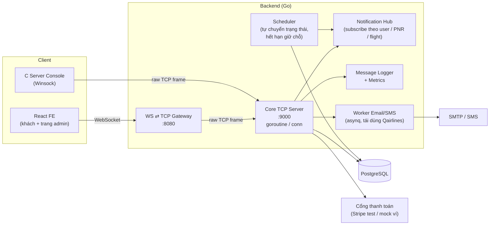
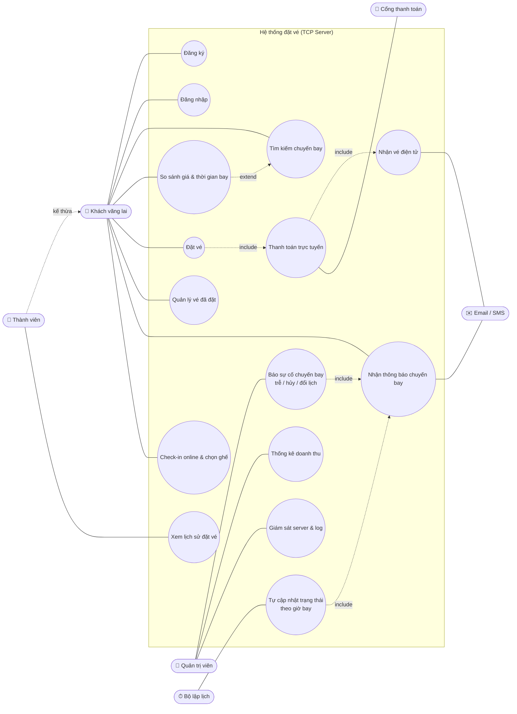
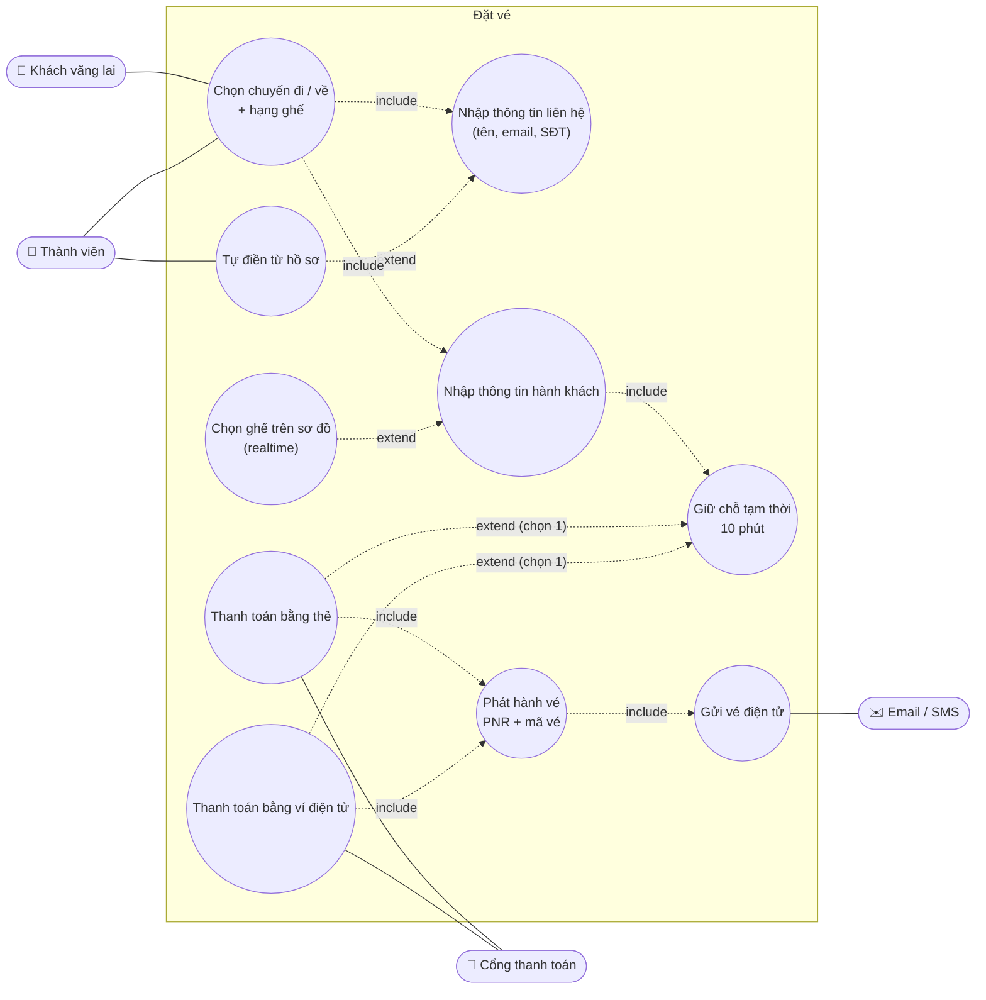
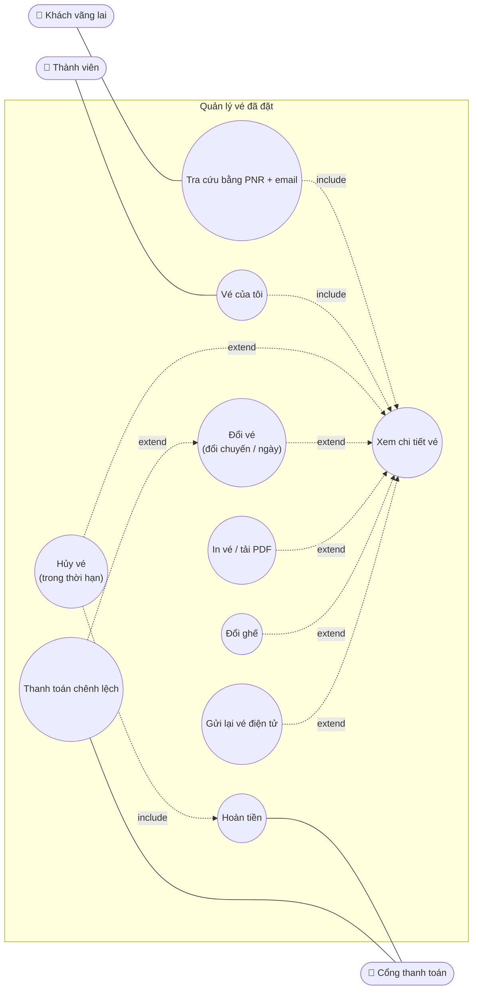
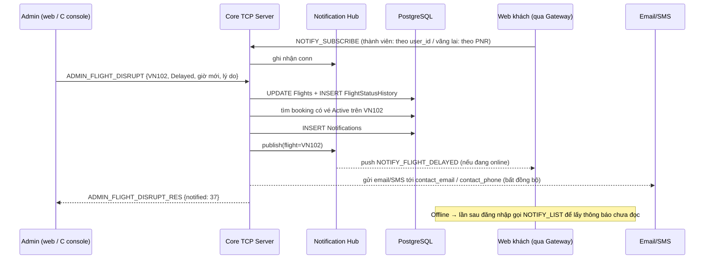
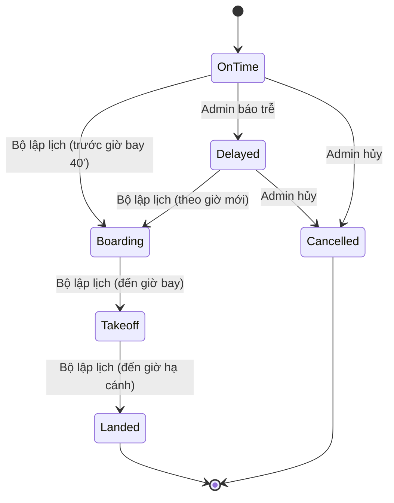

# Hệ thống Đặt vé Máy bay qua Socket TCP — Tổng quan & Kế hoạch

> Tài liệu tổng hợp: hiện trạng (FE + DB của repo này), đối chiếu với hệ thống cũ **Qairlines** (môn Phát triển ứng dụng web), kiến trúc socket đề xuất, sơ đồ use case các chức năng chính (bỏ qua CRUD) và lộ trình.
> Cập nhật: 27/10/2026

---

## 1. Đối chiếu với hệ thống cũ Qairlines

Qairlines (`~/Projects/Qairlines`) là bài tập lớn môn **INT3306 – Phát triển ứng dụng web**: Next.js + Go (Gin, REST, sqlc, Redis/asynq, Stripe). Repo hiện tại đang dùng lại FE và DB của hệ thống đó.

### 1.1. Hệ thống cũ đã có gì

| Nhóm | Đã có trong Qairlines | Ghi chú khi kiểm tra code |
|---|---|---|
| Đăng ký / đăng nhập | ✅ JWT/PASETO, đổi mật khẩu | |
| Tìm chuyến, lọc giá / khung giờ | ✅ | Chưa lọc theo hãng, chưa có hạng ghế ở form tìm kiếm |
| Đặt vé | ✅ `POST /api/booking` | **Bắt buộc đăng nhập** — handler đọc `Authorization: Bearer`, không có token trả 401. FE không chuyển hướng tới trang login, chỉ báo lỗi |
| Thông tin hành khách | ✅ mỗi hành khách: CCCD, họ, tên, SĐT, ngày sinh, giới tính, địa chỉ | Đây là thông tin **hành khách**, không phải thông tin liên hệ của khách vãng lai |
| Tra cứu đặt chỗ bằng mã đặt chỗ + email | ✅ (tab ở trang chủ → booking-management / check-in) | Có ý tưởng "không cần tài khoản", nhưng API phía sau vẫn cần token |
| Thanh toán | ✅ Stripe PaymentIntent (thẻ) | Chưa có ví điện tử |
| Gửi email | 🟡 một email sau khi đặt vé (asynq + Redis) | Nội dung là "ghế đã được cập nhật" + booking ID, **không phải vé điện tử** (không có PNR, không đính kèm PDF) |
| Hủy vé | ✅ | **Không kiểm tra thời hạn được hủy** |
| Đổi vé | ❌ | Chỉ có đổi ghế |
| Thông báo chuyến bay cho khách | ❌ | Admin sửa giờ bay nhưng khách không được thông báo |
| Admin – Dashboard | 🟡 trang thống kê (số chuyến, số vé, **doanh thu**, biểu đồ trạng thái, loại tàu bay) | API `/api/statistic` **trả số cứng** (120 chuyến, 450 vé, 1.145.430.000đ) — chưa tính thật |
| Admin – Chuyến bay | ✅ thêm / sửa / xóa, **đổi giờ khởi hành (delay)** | Trạng thái chuyến bay không tự chuyển theo thời gian |
| Admin – Vé | ✅ xem vé theo chuyến, hủy vé | |
| Admin – Khách hàng, thành viên admin, tin tức, hồ sơ | ✅ | |
| Log | 🟡 log **HTTP request/response** (zerolog → file), log rate-limiter, log recovery | Là log tầng HTTP, không phải log message socket |
| Rate limiting, CORS, gzip, graceful shutdown | ✅ | |
| Giám sát server (kết nối đang mở, lưu lượng message) | ❌ | |
| Giao tiếp realtime (server chủ động đẩy) | ❌ | Toàn bộ là request–response HTTP |

### 1.2. Những gì môn Lập trình mạng yêu cầu mà hệ thống cũ chưa có

1. **Giao tiếp bằng socket** thay cho HTTP/REST, với protocol tự định nghĩa (framing, loại message, mã lỗi).
2. **Log message gửi/nhận ở server** theo từng kết nối (không phải log HTTP).
3. **Server push**: thông báo trễ / hủy / đổi lịch chuyến bay tới khách đang online.
4. **Giám sát server**: số kết nối, ai đang online, lưu lượng message, xem log trực tiếp.
5. **Vé điện tử thật**: mã PNR + mã vé, gửi qua email/SMS.
6. **Đổi vé**, **thanh toán bằng ví điện tử**, **so sánh giữa các hãng** (cần dữ liệu nhiều hãng).
7. Thống kê doanh thu **tính từ dữ liệu thật**.

> Lưu ý: repo hiện tại mới port các **trang khách hàng** từ Qairlines. Các trang `admin/*` (dashboard, flights, tickets, customers, members, news) và `news/*` **chưa được port**, chỉ có vài component trong `components/admin/`.

---

## 2. Hai câu hỏi nghiệp vụ

### 2.1. Khách vãng lai có nên đặt vé được không?

**Có, và đó là cách làm phổ biến hiện nay.** Vietnam Airlines, Vietjet, Bamboo Airways và các trang trung gian (Traveloka, Agoda…) đều cho đặt vé **không cần tài khoản**. Người mua chỉ cần nhập:

- **Thông tin liên hệ** (một lần cho cả đơn): họ tên người liên hệ, **email**, **số điện thoại**. Vé điện tử và thông báo được gửi về đây.
- **Thông tin hành khách** (mỗi người): họ tên đúng giấy tờ, ngày sinh, giới tính, CCCD/hộ chiếu.

Sau đó khách quản lý vé bằng **mã đặt chỗ (PNR) + họ/email**, không cần đăng nhập.

Tài khoản thành viên thêm các lợi ích: tự điền thông tin, xem lịch sử đặt vé, tích điểm (`loyalty_points` đã có trong DB), nhận thông báo realtime trên web.

**Đề xuất cho đồ án:** hỗ trợ cả hai.

| | Khách vãng lai | Thành viên |
|---|---|---|
| Tìm kiếm, so sánh | ✅ | ✅ |
| Đặt vé + thanh toán | ✅ nhập thông tin liên hệ | ✅ tự điền từ hồ sơ |
| Nhận vé điện tử | Email / SMS | Email / SMS + trong tài khoản |
| Quản lý vé (xem, hủy, đổi, in) | Bằng PNR + email | Trong "Vé của tôi" |
| Thông báo chuyến bay | Email / SMS; realtime **khi đang mở trang quản lý vé** (subscribe theo PNR) | Realtime bất cứ khi nào online + hộp thông báo + email |
| Lịch sử, điểm thưởng | ❌ | ✅ |

**DB cần sửa theo:** `Bookings.user_email` đang là khóa ngoại tới `Users(email)` → khách vãng lai sẽ vi phạm ràng buộc. Đổi thành `user_id` (nullable) + `contact_name`, `contact_email`, `contact_phone` + `pnr`.

### 2.2. Ai cập nhật trạng thái chuyến bay: hệ thống hay admin?

**Cả hai, chia theo loại trạng thái.** Trong thực tế, hãng bay không "tự đoán" được chuyến sẽ trễ hay hủy: đó là quyết định của trung tâm điều hành khai thác (do thời tiết, kỹ thuật, kiểm soát không lưu…). Nhưng các trạng thái diễn ra theo giờ thì hệ thống tự chuyển được.

| Loại trạng thái | Ai cập nhật | Cách làm trong đồ án |
|---|---|---|
| `On Time` → `Boarding` → `Takeoff` → `Landed` | **Hệ thống tự động** | Bộ lập lịch (scheduler) chạy mỗi phút, so giờ hiện tại với giờ khởi hành / hạ cánh (vd. Boarding = trước giờ bay 40 phút) |
| `Delayed` (trễ), đổi lịch (đổi giờ / ngày bay), `Cancelled` (hủy) | **Nhân viên điều hành (admin)** | Admin nhập lý do + giờ mới → hệ thống **tự động** tìm khách có vé, lưu thông báo, đẩy realtime, gửi email |
| (tùy chọn, để demo) | **Bộ mô phỏng sự cố** | Chế độ demo: ngẫu nhiên đánh dấu trễ một chuyến để thấy thông báo nảy lên |

Vậy "Cập nhật trạng thái chuyến bay" vẫn là use case của admin, nhưng **chỉ cho sự cố** (trễ / hủy / đổi lịch). Còn **thông báo cho khách là việc hệ thống tự làm**, admin không phải gửi tay.

### 2.3. Vai trò của admin

Kiểm tra code Qairlines: admin quản lý **chuyến bay** (gồm đổi giờ khởi hành), **vé**, **khách hàng**, **thành viên admin**, **tin tức**, và xem **dashboard thống kê có doanh thu** (doanh thu hiện đang là số cứng). Đúng như bạn nhớ.

Với đồ án này, ngoài các chức năng trên, admin có thêm:

- **Báo sự cố chuyến bay** (trễ / hủy / đổi lịch) → kích hoạt thông báo.
- **Thống kê doanh thu thật** (từ bảng `Payments`: theo ngày, theo chuyến, theo hãng, tỷ lệ hủy/hoàn tiền).
- **Giám sát server**: kết nối đang mở, người dùng online, message/giây, xem log realtime, ngắt kết nối một client.

---

## 3. "Full socket TCP bằng C" có được không?

**Được, nhưng có một ràng buộc kỹ thuật phải giải quyết trước:**

> Trình duyệt **không thể mở raw TCP socket**. JavaScript trong browser chỉ có HTTP (`fetch`/XHR) và `WebSocket`. Vì vậy FE React không thể nói chuyện trực tiếp với một TCP server tự viết.

Cần một **gateway WebSocket ⇄ TCP** ở giữa. Ba phương án:

| | Phương án | Mô tả | Ưu | Nhược |
|---|---|---|---|---|
| A | **Core server viết bằng C** | React ⇄ WS ⇄ Gateway ⇄ TCP ⇄ **C server** ⇄ PostgreSQL (libpq) | Phần socket "thuần C" rõ ràng nhất | Phải tự làm JSON (cJSON), libpq, thread pool, bcrypt, email (libcurl), Stripe… Rất tốn công, dễ lỗi bộ nhớ, 2 ngôn ngữ backend |
| **B** | **Core server Go dùng raw TCP + client C** *(khuyến nghị)* | React ⇄ WS ⇄ Gateway (Go) ⇄ TCP ⇄ **Go core server** (`net.Listen`, tự framing, **không REST**). Thêm **C client** (console) cho giám sát server | Mọi giao tiếp đều qua socket với protocol tự định nghĩa; Go mạnh về concurrency; **tái sử dụng được tầng usecase / repository / sqlc / worker email / Stripe của Qairlines**, chỉ thay tầng Gin bằng tầng socket | Phần C chỉ ở client |
| C | Bỏ web, làm client desktop C | Client C ⇄ TCP ⇄ server | Không cần gateway | Bỏ toàn bộ FE React (3 điểm giao diện) |

### Khuyến nghị: **Phương án B**

- **Go core server** nói raw TCP với protocol tự định nghĩa (độ dài + JSON).
- **Gateway** (Go) chỉ chuyển frame WebSocket ⇄ frame TCP. Có thể **tự viết WebSocket handshake + framing (RFC 6455)** trên `net.Conn` để lấy điểm nâng cao.
- **C client (Winsock/POSIX), "Server Console"**: kết nối thẳng TCP vào core server bằng tài khoản admin để:
  - xem log message realtime, danh sách kết nối, thống kê lưu lượng;
  - ngắt một kết nối, gửi broadcast thông báo hệ thống;
  - (tùy chọn) báo sự cố chuyến bay bằng lệnh → web của khách nảy thông báo ngay. Demo rất trực quan khi bảo vệ.
- Nếu giảng viên **bắt buộc server viết bằng C** → phương án A, giữ phạm vi C nhỏ (socket, framing, log, dispatch). Cần hỏi giảng viên trước khi chốt.

---

## 4. Kiến trúc đề xuất (Phương án B)



### 4.1. Protocol tự định nghĩa (đề xuất)

**Framing** (TCP là luồng byte, không có ranh giới message):

```
+----------------+---------------------------------+
| 4 byte length  |  JSON payload (UTF-8, N byte)   |
| (big-endian)   |                                 |
+----------------+---------------------------------+
```

**Envelope:**

```json
{
  "type": "FLIGHT_SEARCH",
  "req_id": "c7f1...",
  "token": "session-token",
  "payload": { }
}
```

- `req_id`: client sinh, server trả lại để ghép request với response.
- `token`: `null` với khách vãng lai.
- Response: `{"type": "FLIGHT_SEARCH_RES", "req_id": "...", "status": "OK" | "ERROR", "error": "...", "payload": {...}}`
- Push từ server (không có `req_id`): `{"type": "NOTIFY_FLIGHT_DELAYED", "payload": {...}}`

**Danh sách message chính** (thay cho các REST endpoint FE đang gọi):

| Nhóm | Message type | Thay cho endpoint cũ |
|---|---|---|
| Kết nối | `HELLO`, `PING` / `PONG` | — |
| Auth | `AUTH_REGISTER`, `AUTH_LOGIN`, `AUTH_LOGOUT`, `AUTH_CHANGE_PASSWORD` | `/api/customer`, `/api/auth/login`, `/api/auth/:id/password` |
| Tìm kiếm | `FLIGHT_SEARCH`, `FLIGHT_GET`, `FLIGHT_COMPARE` | `/api/flight/search`, `/api/flight/:id` |
| Đặt vé | `SEAT_MAP_GET`, `SEAT_HOLD`, `SEAT_RELEASE`, `BOOKING_CREATE` (có `contact` cho khách vãng lai) | `/api/booking` |
| Thanh toán | `PAYMENT_CREATE`, `PAYMENT_CONFIRM` | `/payment-intents` |
| Quản lý vé | `BOOKING_LOOKUP` (PNR + email), `BOOKING_HISTORY`, `TICKET_GET`, `TICKET_CANCEL`, `TICKET_CHANGE`, `TICKET_UPDATE_SEAT`, `TICKET_RESEND` | `/api/booking`, `/api/ticket`, `/api/ticket/cancel`, `/api/ticket/update-seats` |
| Thông báo | `NOTIFY_SUBSCRIBE`, `NOTIFY_LIST`, `NOTIFY_MARK_READ`; push `NOTIFY_FLIGHT_DELAYED`, `NOTIFY_FLIGHT_CANCELLED`, `NOTIFY_FLIGHT_RESCHEDULED`, `NOTIFY_FLIGHT_STATUS`, `SEAT_MAP_CHANGED` | (chưa có) |
| Admin nghiệp vụ | `ADMIN_FLIGHT_DISRUPT` (trễ / hủy / đổi lịch), `ADMIN_STATS_REVENUE` | `/api/flight/update`, `/api/statistic` |
| Giám sát server | `MON_CONNECTIONS`, `MON_METRICS`, `MON_LOG_TAIL` (stream), `MON_KICK`, `MON_BROADCAST` | (chưa có) |

### 4.2. Ghi log message (1 điểm)

Mỗi frame vào/ra ghi một dòng vào `logs/server-YYYYMMDD.log` và stdout, đồng thời đẩy cho các client đang `MON_LOG_TAIL`:

```
2026-10-27T09:15:02.113Z  conn=17  127.0.0.1:52811  user=guest  IN   FLIGHT_SEARCH          req=c7f1  412B
2026-10-27T09:15:02.140Z  conn=17  127.0.0.1:52811  user=guest  OUT  FLIGHT_SEARCH_RES      req=c7f1  OK  6.2KB  27ms
2026-10-27T09:15:40.002Z  conn=03  10.0.0.5:40122   user=42     OUT  NOTIFY_FLIGHT_DELAYED  push  flight=VN102
2026-10-27T09:16:11.870Z  conn=09  10.0.0.7:40555   user=-      SYS  DISCONNECT             reason=heartbeat_timeout
```

Che (mask) mật khẩu, số thẻ, token, CCCD trong log. Có thể tái dùng `pkg/logger` (zerolog) của Qairlines.

---

## 5. Hiện trạng repo này

### 5.1. Frontend (React 19 + Vite, port từ Qairlines)

| Trang / thành phần | File | Trạng thái |
|---|---|---|
| Trang chủ + form tìm chuyến; tab tra cứu đặt chỗ (mã + email) | [pages/index.jsx](../frontend/src/pages/index.jsx), [SearchFlightsForm.jsx](../frontend/src/components/FlightsSearch/SearchFlightsForm.jsx), [FlightBookingTabs.jsx](../frontend/src/components/FlightsSearch/FlightBookingTabs.jsx) | Có. **Thiếu chọn hạng ghế** |
| Danh sách chuyến + lọc giá / khung giờ, chọn chiều đi → về | [pages/flights/index.jsx](../frontend/src/pages/flights/index.jsx), [useFlightData.js](../frontend/src/hooks/useFlightData.js) | Có. **Thiếu lọc hãng, sắp xếp, bảng so sánh** |
| Xác nhận đặt vé + nhập thông tin hành khách | [pages/confirm/index.jsx](../frontend/src/pages/confirm/index.jsx), [PassengerInfoDialog.jsx](../frontend/src/components/PassengerInfoDialog.jsx) | Có code nhưng **route `/confirm` chưa khai báo** trong [App.jsx](../frontend/src/App.jsx). **Thiếu form thông tin liên hệ cho khách vãng lai** |
| Check-in 5 bước (chi tiết → hành khách → chọn ghế → thanh toán Stripe → boarding pass in/PDF) | [pages/check-in/index.jsx](../frontend/src/pages/check-in/index.jsx), [components/checkin/](../frontend/src/components/checkin/) | Có. Thanh toán đang nằm trong check-in thay vì lúc đặt vé; **thiếu ví điện tử** |
| Quản lý đặt chỗ: xem vé, hủy vé, tải PDF | [pages/booking-management/index.jsx](../frontend/src/pages/booking-management/index.jsx), [useFlightBooking.js](../frontend/src/hooks/useFlightBooking.js) | Có. **Thiếu đổi vé**; đang bắt buộc token |
| Tài khoản: thông tin, lịch sử, đổi mật khẩu | [pages/my-account.jsx](../frontend/src/pages/my-account.jsx) | Có |
| Đăng ký / đăng nhập | [login.jsx](../frontend/src/pages/login.jsx), [signup.jsx](../frontend/src/pages/signup.jsx) | Có |
| Admin | [components/admin/](../frontend/src/components/admin/) | **Chỉ có dialog; chưa port các trang admin của Qairlines** |
| Thông báo (chuông, danh sách, toast realtime) | — | **Chưa có** |
| Trang giám sát server | — | **Chưa có** |

Toàn bộ FE đang gọi REST (`fetch`/`axios`) rải rác trong từng hook → gom về **một module client** (vd. `src/services/socket.js`: kết nối WS, gửi `{type, req_id, payload}`, trả Promise theo `req_id`, phát sự kiện cho message push).

### 5.2. Database (PostgreSQL, sqlc — giống Qairlines)

**Vấn đề cần sửa:**

| # | Vấn đề | Ảnh hưởng |
|---|---|---|
| 1 | Migration `000002` chạy `DROP TABLE Users CASCADE` rồi tạo lại → **mất hết khóa ngoại** từ `Bookings`, `News`, `Customers`, `Admins` và mất dữ liệu mẫu user | Toàn vẹn dữ liệu hỏng; `Customers`/`Admins` thành bảng thừa |
| 2 | `Bookings.user_email` là FK tới `Users(email)` | Không cho khách vãng lai đặt vé |
| 3 | Dữ liệu mẫu chỉ có **một hãng** | Không demo được so sánh giữa các hãng |
| 4 | `Flights` chỉ có `base_price` | Không có giá theo hạng ghế |
| 5 | `Seats` có `UNIQUE(seat_id, flight_id)` vô nghĩa | Cần `UNIQUE(flight_id, seat_code)` để chống trùng ghế |
| 6 | Query `UpdateSeat` sửa `seat_code` của dòng ghế thay vì gán vé sang ghế khác | Đổi ghế làm sai sơ đồ ghế |
| 7 | `Tickets.seat_id NOT NULL` nhưng FE chọn ghế ở bước check-in | Mâu thuẫn luồng |
| 8 | Không có PNR / mã vé, bảng thanh toán, thông báo, lịch sử trạng thái, lịch sử đổi vé | Thiếu dữ liệu cho các tính năng bắt buộc và thống kê doanh thu |

**Thay đổi / bổ sung:**

- `Bookings`: `user_id` (nullable), `contact_name`, `contact_email`, `contact_phone`, `pnr` (6 ký tự, unique), `hold_expires_at`
- `Tickets`: `ticket_code` (mã vé điện tử), `seat_id` nullable
- `FlightFares` (flight_id, class, price, seats_total) — giá theo hạng
- `Payments` (booking_id, method `card`/`ewallet`, amount, status, provider_ref, created_at) — nguồn thống kê doanh thu
- `Notifications` (user_id nullable, booking_id, flight_id, type, message, is_read, created_at)
- `FlightStatusHistory` (flight_id, old/new status, old/new time, reason, changed_by `system`/admin_id, changed_at)
- `TicketChanges` (old_ticket_id, new_ticket_id, fee, fare_difference)

---

## 6. Sơ đồ Use Case (chức năng chính, bỏ qua CRUD)

### 6.1. Tác nhân

| Actor | Mô tả |
|---|---|
| **Khách vãng lai** | Không đăng nhập: tìm kiếm, so sánh, **đặt vé bằng thông tin liên hệ**, quản lý vé bằng PNR + email |
| **Thành viên** | Kế thừa Khách vãng lai + lịch sử, tự điền thông tin, thông báo realtime, điểm thưởng |
| **Quản trị viên** | Báo sự cố chuyến bay, xem thống kê doanh thu, giám sát server (qua web admin hoặc C console) |
| **Bộ lập lịch** (hệ thống) | Tự chuyển trạng thái chuyến theo giờ, hủy giữ chỗ hết hạn |
| **Cổng thanh toán** (ngoài) | Stripe (thẻ) / ví điện tử (mock hoặc sandbox) |
| **Dịch vụ Email/SMS** (ngoài) | Gửi vé điện tử, gửi thông báo |

### 6.2. Sơ đồ tổng quát



### 6.3. Chi tiết: Đặt vé & Thanh toán



### 6.4. Chi tiết: Quản lý vé



### 6.5. Chi tiết: Thông báo chuyến bay

**a) Sự cố do admin báo (trễ / hủy / đổi lịch):**



**b) Trạng thái tự động theo giờ:**



Mỗi lần chuyển trạng thái, hệ thống đều tự gửi thông báo cho hành khách của chuyến đó.

---

## 7. Đối chiếu yêu cầu đề bài

| Yêu cầu | Điểm | Qairlines cũ | Repo này (FE / DB) | Việc cần làm |
|---|---|---|---|---|
| Kết nối client–server bằng socket | 2 | ❌ REST | ❌ | Core TCP server, gateway WS⇄TCP, `socket.js` ở FE, C console |
| Ghi log message gửi/nhận | 1 | 🟡 log HTTP | ❌ | Logger mọi frame IN/OUT theo conn, mask dữ liệu nhạy cảm |
| Đăng ký / đăng nhập | 2 | ✅ | ✅ / ✅ | Chuyển sang message socket, session gắn với connection |
| Tìm kiếm theo tiêu chí | 2 | 🟡 | 🟡 thiếu hạng ghế | Thêm hạng ghế; lọc theo số ghế trống ≥ số khách |
| So sánh giá & thời gian bay giữa các hãng | 2 | 🟡 | 🟡 / 1 hãng | Dữ liệu nhiều hãng; lọc hãng; sắp xếp giá / thời lượng / giờ đi; bảng so sánh; nhãn "Rẻ nhất / Nhanh nhất" |
| Đặt vé & thanh toán (thẻ / ví) | 3 | 🟡 bắt buộc login, chỉ thẻ | 🟡 route `/confirm` chưa gắn | Đặt vé cho khách vãng lai; gộp đặt → thanh toán; ví điện tử; giữ chỗ có hạn |
| Nhận vé điện tử (email / SMS) | 2 | 🟡 email không có mã vé | ❌ thiếu PNR | Sinh PNR + mã vé; email HTML + PDF; SMS (mock) |
| Quản lý vé: xem, hủy, đổi, in | 3 | 🟡 thiếu đổi, hủy không kiểm hạn | 🟡 | Đổi vé; chính sách hạn hủy; tra cứu bằng PNR |
| Thông báo: đổi lịch, hủy, trễ | 3 | ❌ | ❌ / 🟡 enum | Scheduler + báo sự cố + Hub push + email; chuông thông báo |
| Giao diện | 3 | ✅ | ✅ | Bổ sung các màn còn thiếu; port trang admin |
| Tính năng nâng cao | 5 | | | Mục 8 |

✅ có · 🟡 có một phần · ❌ chưa có

---

## 8. Tính năng nâng cao (chọn theo sức)

Ưu tiên tính năng **thể hiện kiến thức lập trình mạng**:

| Ưu tiên | Tính năng | Lý do |
|---|---|---|
| ⭐⭐⭐ | **Giám sát server** (web admin + C console): kết nối đang mở, user online, message/giây, log realtime, ngắt kết nối | Hệ thống cũ chưa có; đúng trọng tâm môn học |
| ⭐⭐⭐ | **Sơ đồ ghế realtime + khóa ghế đồng thời** | Nhiều client cùng xem một chuyến, ghế được giữ đổi màu ngay (broadcast); xử lý 2 người cùng bấm một ghế |
| ⭐⭐⭐ | **Heartbeat, timeout, tự kết nối lại** | PING/PONG phát hiện kết nối chết; client tự reconnect và subscribe lại |
| ⭐⭐ | **Tự cài WebSocket (RFC 6455)** ở gateway | Hiểu giao thức tầng ứng dụng trên TCP |
| ⭐⭐ | **Thống kê doanh thu thật** + biểu đồ (dashboard cũ đã có UI) | Thay số cứng bằng số liệu từ `Payments` |
| ⭐⭐ | **TLS** trên kết nối TCP (`crypto/tls`) | Bảo vệ thông tin thẻ, mật khẩu |
| ⭐⭐ | **Check-in online + boarding pass** | UI đã có sẵn |
| ⭐ | **Chat hỗ trợ realtime** (thay form liên hệ) | Ứng dụng socket hai chiều |
| ⭐ | **Rate limiting theo connection / IP** | Qairlines có cho HTTP, làm lại cho socket |
| ⭐ | **Điểm thưởng thành viên** | Cột `loyalty_points` đã có |
| ⭐ | **Lịch giá rẻ ±3 ngày** | Tăng giá trị phần so sánh |

---

## 9. Lộ trình

| Giai đoạn | Nội dung | Kiểm chứng |
|---|---|---|
| **0. Chốt thiết kế** | Hỏi giảng viên (mục 10); chốt protocol thành `docs/PROTOCOL.md` | Tài liệu protocol |
| **1. Sửa DB** | Migration `000003`: khôi phục FK, gộp `Customers`/`Admins`, `Bookings` hỗ trợ khách vãng lai + PNR, bảng mới ở mục 5.2; dữ liệu nhiều hãng | `migrate up/down` chạy sạch |
| **2. Khung socket** | Core TCP server (accept, goroutine/conn, framing, dispatch, logger) + gateway + `socket.js`; `HELLO`, `PING` | Web gửi PING nhận PONG; log đủ hai chiều |
| **3. Tái dùng Qairlines** | Copy tầng usecase / repository / sqlc / worker email / Stripe; viết handler socket thay handler Gin | Các usecase cũ chạy qua socket |
| **4. Auth** | `AUTH_*`; login/signup FE qua socket | |
| **5. Tìm kiếm & so sánh** | `FLIGHT_SEARCH`, `FLIGHT_COMPARE`; FE thêm hạng ghế, lọc hãng, sắp xếp, bảng so sánh | |
| **6. Đặt vé & thanh toán** | Gắn route `/confirm`; form liên hệ cho khách vãng lai; `SEAT_HOLD`, `BOOKING_CREATE`, `PAYMENT_*`; transaction chống trùng ghế | Đặt vé khứ hồi nhiều khách, cả có và không đăng nhập |
| **7. Vé điện tử** | PNR + mã vé; email HTML + PDF | Email tới hộp thư thật |
| **8. Quản lý vé** | Tra cứu PNR; xem / hủy (có hạn) / **đổi** / in; gửi lại vé | |
| **9. Thông báo** | Scheduler, `ADMIN_FLIGHT_DISRUPT`, Hub, `NOTIFY_*`, chuông FE, email | Admin báo trễ → web khách nhận ngay |
| **10. Admin & giám sát** | Port trang admin cũ; thống kê doanh thu thật; `MON_*`; C console | |
| **11. Nâng cao & hoàn thiện** | Chọn từ mục 8; kiểm thử nhiều client đồng thời; báo cáo, slide | |

---

## 10. Câu hỏi còn mở

1. Giảng viên có **bắt buộc server viết bằng C** không? (quyết định phương án A hay B)
2. Chặng browser → gateway dùng WebSocket có được chấp nhận là "socket" không, hay client cũng phải là TCP thuần?
3. Thanh toán: Stripe test mode thật hay mock? Ví điện tử dùng sandbox (MoMo / ZaloPay) hay mock?
4. Vé điện tử qua email là đủ, hay cần cả SMS? (SMS tốn phí, có thể mock bằng log hoặc Telegram bot)
5. Chính sách hủy / đổi vé: hạn bao lâu trước giờ bay, phí bao nhiêu?
