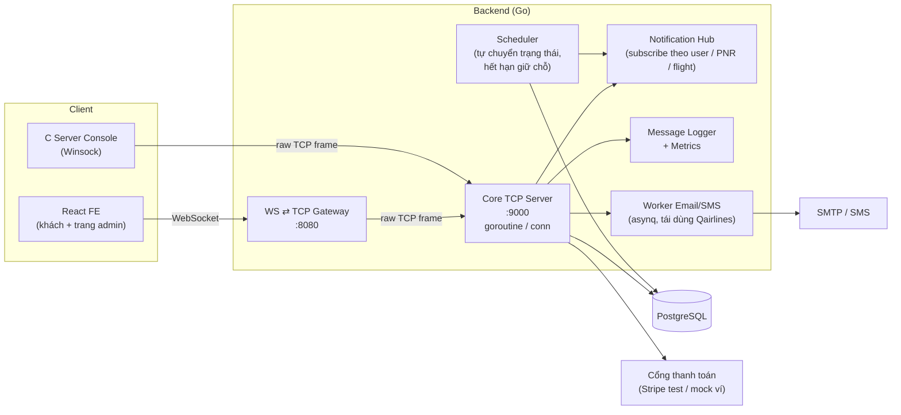
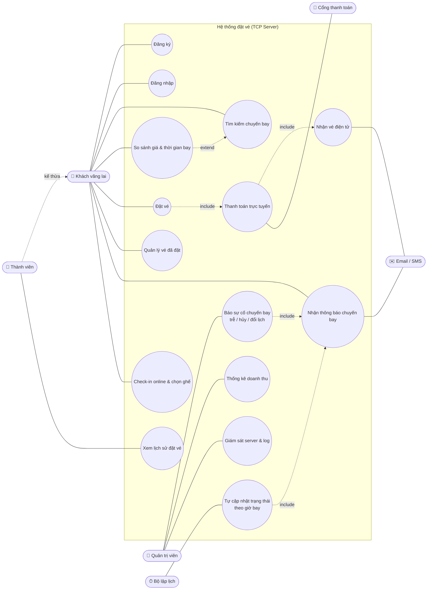
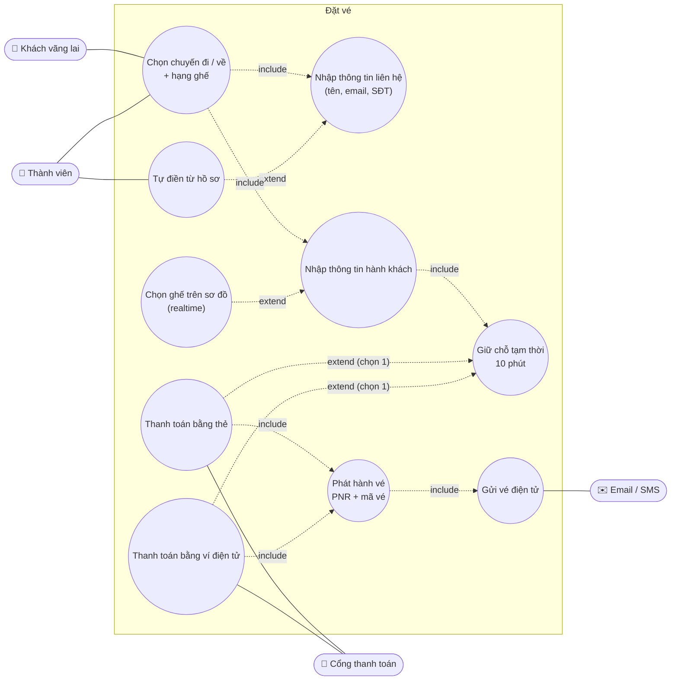
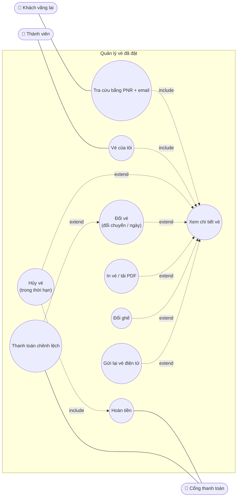
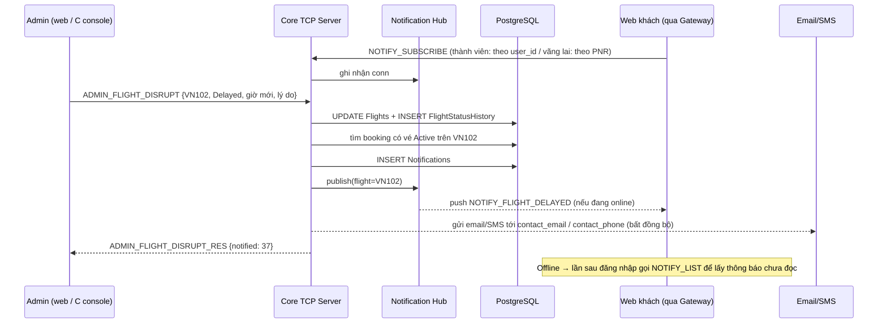
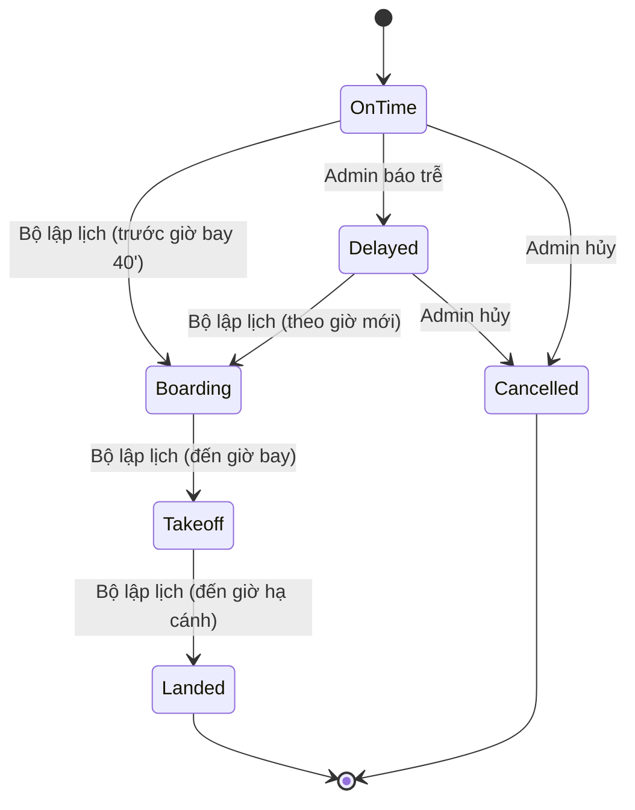

# Hệ thống Đặt vé Máy bay qua Socket TCP — Tổng quan & Kế hoạch

> Tài liệu tổng hợp: hiện trạng (FE + DB của repo này), đối chiếu với hệ thống cũ **Qairlines** (môn Phát triển ứng dụng web), kiến trúc socket đề xuất, sơ đồ use case các chức năng chính (bỏ qua CRUD) và lộ trình.
> Cập nhật: 10/11/2026

---

## 1. Đối chiếu với hệ thống cũ Qairlines

Qairlines (`~/Projects/Qairlines`) là bài tập lớn môn **INT3306 – Phát triển ứng dụng web**: Next.js + Go (Gin, REST, sqlc, Redis/asynq, Stripe). Repo hiện tại đang dùng lại FE và DB của hệ thống đó.

### 1.1. Hệ thống cũ đã có gì

| Nhóm | Đã có trong Qairlines | Ghi chú khi kiểm tra code |
|---|---|---|
| Đăng ký / đăng nhập | ✅ JWT/PASETO, đổi mật khẩu | |
| Tìm chuyến, lọc giá / khung giờ | ✅ | Chưa lọc theo hãng, chưa có hạng ghế ở form tìm kiếm |
| Đặt vé | ✅ `POST /api/booking` | **Bắt buộc đăng nhập** — handler đọc `Authorization: Bearer`, không có token trả 401. FE không chuyển hướng tới trang login, chỉ báo lỗi |
| Thông tin hành khách | ✅ mỗi hành khách: CCCD, họ, tên, SĐT, ngày sinh, giới tính, địa chỉ | Đây là thông tin **hành khách**, không phải thông tin liên hệ của khách vãng lai |
| Tra cứu đặt chỗ bằng mã đặt chỗ + email | ✅ (tab ở trang chủ → booking-management / check-in) | Có ý tưởng "không cần tài khoản", nhưng API phía sau vẫn cần token |
| Thanh toán | ✅ Stripe PaymentIntent (thẻ) | Chưa có ví điện tử |
| Gửi email | 🟡 một email sau khi đặt vé (asynq + Redis) | Nội dung là "ghế đã được cập nhật" + booking ID, **không phải vé điện tử** (không có PNR, không đính kèm PDF) |
| Hủy vé | ✅ | **Không kiểm tra thời hạn được hủy** |
| Đổi vé | ❌ | Chỉ có đổi ghế |
| Thông báo chuyến bay cho khách | ❌ | Admin sửa giờ bay nhưng khách không được thông báo |
| Admin – Dashboard | 🟡 trang thống kê (số chuyến, số vé, **doanh thu**, biểu đồ trạng thái, loại tàu bay) | API `/api/statistic` **trả số cứng** (120 chuyến, 450 vé, 1.145.430.000đ) — chưa tính thật |
| Admin – Chuyến bay | ✅ thêm / sửa / xóa, **đổi giờ khởi hành (delay)** | Trạng thái chuyến bay không tự chuyển theo thời gian |
| Admin – Vé | ✅ xem vé theo chuyến, hủy vé | |
| Admin – Khách hàng, thành viên admin, tin tức, hồ sơ | ✅ | |
| Log | 🟡 log **HTTP request/response** (zerolog → file), log rate-limiter, log recovery | Là log tầng HTTP, không phải log message socket |
| Rate limiting, CORS, gzip, graceful shutdown | ✅ | |
| Giám sát server (kết nối đang mở, lưu lượng message) | ❌ | |
| Giao tiếp realtime (server chủ động đẩy) | ❌ | Toàn bộ là request–response HTTP |

### 1.2. Những gì môn Lập trình mạng yêu cầu mà hệ thống cũ chưa có

1. **Giao tiếp bằng socket** thay cho HTTP/REST, với protocol tự định nghĩa (framing, loại message, mã lỗi).
2. **Log message gửi/nhận ở server** theo từng kết nối (không phải log HTTP).
3. **Server push**: thông báo trễ / hủy / đổi lịch chuyến bay tới khách đang online.
4. **Giám sát server**: số kết nối, ai đang online, lưu lượng message, xem log trực tiếp.
5. **Vé điện tử thật**: mã PNR + mã vé, gửi qua email/SMS.
6. **Đổi vé**, **thanh toán bằng ví điện tử**, **so sánh giữa các hãng** (cần dữ liệu nhiều hãng).
7. Thống kê doanh thu **tính từ dữ liệu thật**.

> Lưu ý: repo hiện tại mới port các **trang khách hàng** từ Qairlines. Các trang `admin/*` (dashboard, flights, tickets, customers, members, news) và `news/*` **chưa được port**, chỉ có vài component trong `components/admin/`.

---

## 2. Hai câu hỏi nghiệp vụ

### 2.1. Khách vãng lai có nên đặt vé được không?

**Có, và đó là cách làm phổ biến hiện nay.** Vietnam Airlines, Vietjet, Bamboo Airways và các trang trung gian (Traveloka, Agoda…) đều cho đặt vé **không cần tài khoản**. Người mua chỉ cần nhập:

- **Thông tin liên hệ** (một lần cho cả đơn): họ tên người liên hệ, **email**, **số điện thoại**. Vé điện tử và thông báo được gửi về đây.
- **Thông tin hành khách** (mỗi người): họ tên đúng giấy tờ, ngày sinh, giới tính, CCCD/hộ chiếu.

Sau đó khách quản lý vé bằng **mã đặt chỗ (PNR) + họ/email**, không cần đăng nhập.

Tài khoản thành viên thêm các lợi ích: tự điền thông tin, xem lịch sử đặt vé, tích điểm (`loyalty_points` đã có trong DB), nhận thông báo realtime trên web.

**Đề xuất cho đồ án:** hỗ trợ cả hai.

| | Khách vãng lai | Thành viên |
|---|---|---|
| Tìm kiếm, so sánh | ✅ | ✅ |
| Đặt vé + thanh toán | ✅ nhập thông tin liên hệ | ✅ tự điền từ hồ sơ |
| Nhận vé điện tử | Email / SMS | Email / SMS + trong tài khoản |
| Quản lý vé (xem, hủy, đổi, in) | Bằng PNR + email | Trong "Vé của tôi" |
| Thông báo chuyến bay | Email / SMS; realtime **khi đang mở trang quản lý vé** (subscribe theo PNR) | Realtime bất cứ khi nào online + hộp thông báo + email |
| Lịch sử, điểm thưởng | ❌ | ✅ |

**DB cần sửa theo:** `Bookings.user_email` đang là khóa ngoại tới `Users(email)` → khách vãng lai sẽ vi phạm ràng buộc. Đổi thành `user_id` (nullable) + `contact_name`, `contact_email`, `contact_phone` + `pnr`.

### 2.2. Ai cập nhật trạng thái chuyến bay: hệ thống hay admin?

**Cả hai, chia theo loại trạng thái.** Trong thực tế, hãng bay không "tự đoán" được chuyến sẽ trễ hay hủy: đó là quyết định của trung tâm điều hành khai thác (do thời tiết, kỹ thuật, kiểm soát không lưu…). Nhưng các trạng thái diễn ra theo giờ thì hệ thống tự chuyển được.

| Loại trạng thái | Ai cập nhật | Cách làm trong đồ án |
|---|---|---|
| `On Time` → `Boarding` → `Takeoff` → `Landed` | **Hệ thống tự động** | Bộ lập lịch (scheduler) chạy mỗi phút, so giờ hiện tại với giờ khởi hành / hạ cánh (vd. Boarding = trước giờ bay 40 phút) |
| `Delayed` (trễ), đổi lịch (đổi giờ / ngày bay), `Cancelled` (hủy) | **Nhân viên điều hành (admin)** | Admin nhập lý do + giờ mới → hệ thống **tự động** tìm khách có vé, lưu thông báo, đẩy realtime, gửi email |
| (tùy chọn, để demo) | **Bộ mô phỏng sự cố** | Chế độ demo: ngẫu nhiên đánh dấu trễ một chuyến để thấy thông báo nảy lên |

Vậy "Cập nhật trạng thái chuyến bay" vẫn là use case của admin, nhưng **chỉ cho sự cố** (trễ / hủy / đổi lịch). Còn **thông báo cho khách là việc hệ thống tự làm**, admin không phải gửi tay.

### 2.3. Vai trò của admin

Kiểm tra code Qairlines: admin quản lý **chuyến bay** (gồm đổi giờ khởi hành), **vé**, **khách hàng**, **thành viên admin**, **tin tức**, và xem **dashboard thống kê có doanh thu** (doanh thu hiện đang là số cứng). Đúng như bạn nhớ.

Với đồ án này, ngoài các chức năng trên, admin có thêm:

- **Báo sự cố chuyến bay** (trễ / hủy / đổi lịch) → kích hoạt thông báo.
- **Thống kê doanh thu thật** (từ bảng `Payments`: theo ngày, theo chuyến, theo hãng, tỷ lệ hủy/hoàn tiền).
- **Giám sát server**: kết nối đang mở, người dùng online, message/giây, xem log realtime, ngắt kết nối một client.

---

## 3. "Full socket TCP bằng C" có được không?

**Được, nhưng có một ràng buộc kỹ thuật phải giải quyết trước:**

> Trình duyệt **không thể mở raw TCP socket**. JavaScript trong browser chỉ có HTTP (`fetch`/XHR) và `WebSocket`. Vì vậy FE React không thể nói chuyện trực tiếp với một TCP server tự viết.

Cần một **gateway WebSocket ⇄ TCP** ở giữa. Ba phương án:

| | Phương án | Mô tả | Ưu | Nhược |
|---|---|---|---|---|
| A | **Core server viết bằng C** | React ⇄ WS ⇄ Gateway ⇄ TCP ⇄ **C server** ⇄ PostgreSQL (libpq) | Phần socket "thuần C" rõ ràng nhất | Phải tự làm JSON (cJSON), libpq, thread pool, bcrypt, email (libcurl), Stripe… Rất tốn công, dễ lỗi bộ nhớ, 2 ngôn ngữ backend |
| **B** | **Core server Go dùng raw TCP + client C** *(khuyến nghị)* | React ⇄ WS ⇄ Gateway (Go) ⇄ TCP ⇄ **Go core server** (`net.Listen`, tự framing, **không REST**). Thêm **C client** (console) cho giám sát server | Mọi giao tiếp đều qua socket với protocol tự định nghĩa; Go mạnh về concurrency; **tái sử dụng được tầng usecase / repository / sqlc / worker email / Stripe của Qairlines**, chỉ thay tầng Gin bằng tầng socket | Phần C chỉ ở client |
| C | Bỏ web, làm client desktop C | Client C ⇄ TCP ⇄ server | Không cần gateway | Bỏ toàn bộ FE React (3 điểm giao diện) |

> **Cập nhật (đã chốt): Phương án D — C làm toàn bộ tầng mạng, Go làm nghiệp vụ.** C (`backend/netcore/`) tự xử lý TCP, framing, CRC, ACK/retry, chống trùng, heartbeat, WebSocket, session/push, log, giám sát. Go giữ domain, usecase, Postgres, mail, Stripe, scheduler và nhận việc từ C qua kênh nội bộ. Không có gateway viết bằng ngôn ngữ khác: phần WebSocket là một module của server C. Chi tiết xem [KIEN-TRUC-MANG-C-GO.md](KIEN-TRUC-MANG-C-GO.md). Mục 3 và sơ đồ mục 4 bên dưới giữ lại làm lịch sử so sánh phương án, **phần "Core TCP Server" và "Gateway" trong đó nay thuộc `netcore` (C)**.

### Khuyến nghị ban đầu: **Phương án B** (đã thay bằng D)

- **Go core server** nói raw TCP với protocol tự định nghĩa (độ dài + JSON).
- **Gateway** (Go) chỉ chuyển frame WebSocket ⇄ frame TCP. Có thể **tự viết WebSocket handshake + framing (RFC 6455)** trên `net.Conn` để lấy điểm nâng cao.
- **C client (Winsock/POSIX), "Server Console"**: kết nối thẳng TCP vào core server bằng tài khoản admin để:
  - xem log message realtime, danh sách kết nối, thống kê lưu lượng;
  - ngắt một kết nối, gửi broadcast thông báo hệ thống;
  - (tùy chọn) báo sự cố chuyến bay bằng lệnh → web của khách nảy thông báo ngay. Demo rất trực quan khi bảo vệ.
- Nếu giảng viên **bắt buộc server viết bằng C** → phương án A, giữ phạm vi C nhỏ (socket, framing, log, dispatch). Cần hỏi giảng viên trước khi chốt.

---

## 4. Kiến trúc đề xuất (Phương án B — bản gốc, nay xem KIEN-TRUC-MANG-C-GO.md)

> Sơ đồ dưới đây vẫn đúng về luồng nghiệp vụ và danh sách message. Điểm khác so với bản đã chốt: "WS ⇄ TCP Gateway" và "Core TCP Server" nay là một chương trình C (`netcore`), còn "Notification Hub", usecase, DB, worker, scheduler nằm ở Go. Protocol thực tế dùng header nhị phân 24 byte có CRC/seq/ack thay cho khung `4 byte length + JSON` ở mục 4.1 (envelope JSON vẫn là payload).



### 4.1. Protocol tự định nghĩa (đề xuất)

**Framing** (TCP là luồng byte, không có ranh giới message):

```
+----------------+---------------------------------+
| 4 byte length  |  JSON payload (UTF-8, N byte)   |
| (big-endian)   |                                 |
+----------------+---------------------------------+
```

**Envelope:**

```json
{
  "type": "FLIGHT_SEARCH",
  "req_id": "c7f1...",
  "token": "session-token",
  "payload": { }
}
```

- `req_id`: client sinh, server trả lại để ghép request với response.
- `token`: `null` với khách vãng lai.
- Response: `{"type": "FLIGHT_SEARCH_RES", "req_id": "...", "status": "OK" | "ERROR", "error": "...", "payload": {...}}`
- Push từ server (không có `req_id`): `{"type": "NOTIFY_FLIGHT_DELAYED", "payload": {...}}`

**Danh sách message chính** (thay cho các REST endpoint FE đang gọi):

| Nhóm | Message type | Thay cho endpoint cũ |
|---|---|---|
| Kết nối | `HELLO`, `PING` / `PONG` | — |
| Auth | `AUTH_REGISTER`, `AUTH_LOGIN`, `AUTH_LOGOUT`, `AUTH_CHANGE_PASSWORD` | `/api/customer`, `/api/auth/login`, `/api/auth/:id/password` |
| Tìm kiếm | `FLIGHT_SEARCH`, `FLIGHT_GET`, `FLIGHT_COMPARE` | `/api/flight/search`, `/api/flight/:id` |
| Đặt vé | `SEAT_MAP_GET`, `SEAT_HOLD`, `SEAT_RELEASE`, `BOOKING_CREATE` (có `contact` cho khách vãng lai) | `/api/booking` |
| Thanh toán | `PAYMENT_CREATE`, `PAYMENT_CONFIRM` | `/payment-intents` |
| Quản lý vé | `BOOKING_LOOKUP` (PNR + email), `BOOKING_HISTORY`, `TICKET_GET`, `TICKET_CANCEL`, `TICKET_CHANGE`, `TICKET_UPDATE_SEAT`, `TICKET_RESEND` | `/api/booking`, `/api/ticket`, `/api/ticket/cancel`, `/api/ticket/update-seats` |
| Thông báo | `NOTIFY_SUBSCRIBE`, `NOTIFY_LIST`, `NOTIFY_MARK_READ`; push `NOTIFY_FLIGHT_DELAYED`, `NOTIFY_FLIGHT_CANCELLED`, `NOTIFY_FLIGHT_RESCHEDULED`, `NOTIFY_FLIGHT_STATUS`, `SEAT_MAP_CHANGED` | (chưa có) |
| Admin nghiệp vụ | `ADMIN_FLIGHT_DISRUPT` (trễ / hủy / đổi lịch), `ADMIN_STATS_REVENUE` | `/api/flight/update`, `/api/statistic` |
| Giám sát server | `MON_CONNECTIONS`, `MON_METRICS`, `MON_LOG_TAIL` (stream), `MON_KICK`, `MON_BROADCAST` | (chưa có) |

### 4.2. Ghi log message (1 điểm)

Mỗi frame vào/ra ghi một dòng vào `logs/server-YYYYMMDD.log` và stdout, đồng thời đẩy cho các client đang `MON_LOG_TAIL`:

```
2026-10-27T09:15:02.113Z  conn=17  127.0.0.1:52811  user=guest  IN   FLIGHT_SEARCH          req=c7f1  412B
2026-10-27T09:15:02.140Z  conn=17  127.0.0.1:52811  user=guest  OUT  FLIGHT_SEARCH_RES      req=c7f1  OK  6.2KB  27ms
2026-10-27T09:15:40.002Z  conn=03  10.0.0.5:40122   user=42     OUT  NOTIFY_FLIGHT_DELAYED  push  flight=VN102
2026-10-27T09:16:11.870Z  conn=09  10.0.0.7:40555   user=-      SYS  DISCONNECT             reason=heartbeat_timeout
```

Che (mask) mật khẩu, số thẻ, token, CCCD trong log. Có thể tái dùng `pkg/logger` (zerolog) của Qairlines.

---

## 5. Hiện trạng repo này

### 5.1. Frontend (React 19 + Vite, port từ Qairlines)

| Trang / thành phần | File | Trạng thái |
|---|---|---|
| Trang chủ + form tìm chuyến; tab tra cứu đặt chỗ (mã + email) | [pages/index.jsx](../frontend/src/pages/index.jsx), [SearchFlightsForm.jsx](../frontend/src/components/FlightsSearch/SearchFlightsForm.jsx), [FlightBookingTabs.jsx](../frontend/src/components/FlightsSearch/FlightBookingTabs.jsx) | Có. **Thiếu chọn hạng ghế** |
| Danh sách chuyến + lọc giá / khung giờ, chọn chiều đi → về | [pages/flights/index.jsx](../frontend/src/pages/flights/index.jsx), [useFlightData.js](../frontend/src/hooks/useFlightData.js) | Có. **Thiếu lọc hãng, sắp xếp, bảng so sánh** |
| Xác nhận đặt vé + nhập thông tin hành khách | [pages/confirm/index.jsx](../frontend/src/pages/confirm/index.jsx), [PassengerInfoDialog.jsx](../frontend/src/components/PassengerInfoDialog.jsx) | Có code nhưng **route `/confirm` chưa khai báo** trong [App.jsx](../frontend/src/App.jsx). **Thiếu form thông tin liên hệ cho khách vãng lai** |
| Check-in 5 bước (chi tiết → hành khách → chọn ghế → thanh toán Stripe → boarding pass in/PDF) | [pages/check-in/index.jsx](../frontend/src/pages/check-in/index.jsx), [components/checkin/](../frontend/src/components/checkin/) | Có. Thanh toán đang nằm trong check-in thay vì lúc đặt vé; **thiếu ví điện tử** |
| Quản lý đặt chỗ: xem vé, hủy vé, tải PDF | [pages/booking-management/index.jsx](../frontend/src/pages/booking-management/index.jsx), [useFlightBooking.js](../frontend/src/hooks/useFlightBooking.js) | Có. **Thiếu đổi vé**; đang bắt buộc token |
| Tài khoản: thông tin, lịch sử, đổi mật khẩu | [pages/my-account.jsx](../frontend/src/pages/my-account.jsx) | Có |
| Đăng ký / đăng nhập | [login.jsx](../frontend/src/pages/login.jsx), [signup.jsx](../frontend/src/pages/signup.jsx) | Có |
| Admin | [components/admin/](../frontend/src/components/admin/) | **Chỉ có dialog; chưa port các trang admin của Qairlines** |
| Thông báo (chuông, danh sách, toast realtime) | — | **Chưa có** |
| Trang giám sát server | — | **Chưa có** |

Toàn bộ FE đang gọi REST (`fetch`/`axios`) rải rác trong từng hook → gom về **một module client** (vd. `src/services/socket.js`: kết nối WS, gửi `{type, req_id, payload}`, trả Promise theo `req_id`, phát sự kiện cho message push).

### 5.2. Database (PostgreSQL, sqlc — giống Qairlines)

**Trạng thái: ✅ đã sửa toàn bộ** bằng migration `000003`–`000004` và file chạy một lần [full_setup.sql](../backend/db/full_setup.sql). Đã kiểm thử trên PostgreSQL 17 (chạy up, down, up và chạy `full_setup.sql` hai lần liên tiếp); cả 99 query trong [backend/db/query/](../backend/db/query/) hợp lệ với schema mới.

| # | Vấn đề (hệ thống cũ) | Trạng thái | Cách xử lý |
|---|---|---|---|
| 1 | Migration `000002` chạy `DROP TABLE Users CASCADE` → mất khóa ngoại và dữ liệu | ✅ | Khôi phục trigger và FK của `News`, bỏ `Customers`/`Admins` (đã gộp vào `Users` theo `role`) |
| 2 | `Bookings.user_email` là FK tới `Users(email)`, không cho khách vãng lai đặt vé | ✅ | `user_id` nullable + `contact_name/email/phone` |
| 3 | Dữ liệu mẫu chỉ có một hãng | ✅ | Bảng `Airlines`, seed 4 hãng, 147 chuyến, các tuyến HAN↔SGN, HAN↔DAD... |
| 4 | `Flights` chỉ có `base_price` | ✅ | `FlightFares` giá theo hạng (`economy`/`business`) |
| 5 | `Seats` có `UNIQUE(seat_id, flight_id)` vô nghĩa | ✅ | `UNIQUE(flight_id, seat_code)` |
| 6 | Query `UpdateSeat` sửa sai `seat_code` | ✅ | Thay bằng `AssignSeatToTicket`, `HoldSeat`, `BookSeat`, `ReleaseSeat*` |
| 7 | `Tickets.seat_id NOT NULL` mâu thuẫn luồng chọn ghế | ✅ | `seat_id` nullable; chỉ mục unique một phần cho ghế của vé còn hiệu lực |
| 8 | Thiếu PNR/mã vé, thanh toán, thông báo, lịch sử trạng thái, lịch sử đổi vé | ✅ | `Bookings.pnr`, `Tickets.ticket_code`, `Payments`, `Notifications`, `FlightStatusHistory`, `TicketChanges` |

**Schema mới (tóm tắt):**

- `Airlines` (code, name, logo_url); `Flights.airline_id`
- `FlightFares` (flight_id, class, price, seats_total)
- `Bookings`: `user_id` (nullable), `contact_*`, `pnr` (unique), `total_amount`, `hold_expires_at`; enum `booking_status` có thêm `expired`
- `Seats`: `status` (`available`/`held`/`booked`), `held_until`, `held_by_booking`
- `Tickets`: `ticket_code`, `seat_id` nullable; enum `ticket_status` có thêm `Changed`, `CheckedIn`
- `Payments` (method `card`/`ewallet`, status, provider_ref) — nguồn thống kê doanh thu
- `Notifications`, `FlightStatusHistory` (`changed_by` NULL = hệ thống tự cập nhật), `TicketChanges`

**Cách dùng:**

- Dựng DB mới kèm dữ liệu mẫu: `psql -U postgres -d <db> -f backend/db/full_setup.sql` (xóa và tạo lại bảng của dự án; chạy độc lập, không dùng chung với thư mục `migrations/` trên cùng một DB). Tài khoản mẫu `admin@qairlines.vn`, `john.doe@example.com`, `alice@example.com`, mật khẩu `123456`; PNR mẫu `AB12CD`, `GU35ST` (khách vãng lai), `PD77XY` (đang giữ chỗ).
- Nâng cấp DB đang có theo từng bước: `backend/db/migrations/000003`–`000004`.
- Lưu ý: code Go của Qairlines (sqlc đã sinh) sẽ không biên dịch được với query mới cho đến khi chạy lại `sqlc generate` và sửa các chỗ gọi, vì tên cột và tham số thay đổi.

---

## 6. Sơ đồ Use Case (chức năng chính, bỏ qua CRUD)

### 6.1. Tác nhân

| Actor | Mô tả |
|---|---|
| **Khách vãng lai** | Không đăng nhập: tìm kiếm, so sánh, **đặt vé bằng thông tin liên hệ**, quản lý vé bằng PNR + email |
| **Thành viên** | Kế thừa Khách vãng lai + lịch sử, tự điền thông tin, thông báo realtime, điểm thưởng |
| **Quản trị viên** | Báo sự cố chuyến bay, xem thống kê doanh thu, giám sát server (qua web admin hoặc C console) |
| **Bộ lập lịch** (hệ thống) | Tự chuyển trạng thái chuyến theo giờ, hủy giữ chỗ hết hạn |
| **Cổng thanh toán** (ngoài) | Stripe (thẻ) / ví điện tử (mock hoặc sandbox) |
| **Dịch vụ Email/SMS** (ngoài) | Gửi vé điện tử, gửi thông báo |

### 6.2. Sơ đồ tổng quát



### 6.3. Chi tiết: Đặt vé & Thanh toán



### 6.4. Chi tiết: Quản lý vé



### 6.5. Chi tiết: Thông báo chuyến bay

**a) Sự cố do admin báo (trễ / hủy / đổi lịch):**



**b) Trạng thái tự động theo giờ:**



Mỗi lần chuyển trạng thái, hệ thống đều tự gửi thông báo cho hành khách của chuyến đó.

---

## 7. Chức năng chấm điểm và hiện trạng

Bố cục theo từng chức năng của đề bài. Mỗi chức năng ghi rõ phần **giao vận (C)**, **nghiệp vụ (Go + DB)** và **giao diện (FE)**, kèm trạng thái. Thứ tự làm xem mục 9.

✅ xong · 🟡 có một phần · ⬜ chưa làm

### 7.0. Tổng hợp

| # | Chức năng | Điểm đề bài | Giao vận (C) | Nghiệp vụ (Go + DB) | Giao diện (FE) | Giai đoạn |
|---:|---|---|---|---|---|---|
| 1 | Kết nối client–server bằng socket | 2 | ⬜ | ✅ kênh nội bộ | ⬜ | 1, 2 |
| 2 | Đăng nhập | 2 (cùng đăng ký) | ⬜ chuyển tiếp | ✅ | 🟡 | 2 |
| 3 | Đăng ký | | ⬜ chuyển tiếp | ✅ | 🟡 | 2 |
| 4 | Tìm kiếm chuyến bay | 2 | ⬜ chuyển tiếp | 🟡 | 🟡 | 3 |
| 5 | Lọc theo điểm đi/đến, ngày, số hành khách, hạng ghế | | ⬜ chuyển tiếp | 🟡 SQL đã có | ⬜ | 3 |
| 6 | So sánh giá và thời gian bay giữa các hãng | 2 | ⬜ chuyển tiếp | 🟡 DB 4 hãng | ⬜ | 3 |
| 7 | Admin: quản lý chuyến bay, vé, khách hàng | nâng cao (5) | ⬜ chuyển tiếp | 🟡 | ⬜ | 9 |
| 8 | Admin: thống kê doanh thu từ dữ liệu thật | nâng cao | ⬜ chuyển tiếp | 🟡 SQL đã có | ⬜ | 9 |
| 9 | Admin: giám sát server (web admin + C Server Console) | nâng cao | ⬜ **chủ yếu ở C** | 🟡 | ⬜ | 9 (số liệu từ 1) |
| 10 | Ghi log message gửi/nhận | 1 | ⬜ **log chính ở C** | ✅ log bridge | — | 1 |
| 11 | Chọn ghế | (thuộc đặt vé) | ⬜ broadcast đáng tin | 🟡 SQL đã có | 🟡 | 4 |
| 12 | Đặt vé và thanh toán mô phỏng | 3 | ⬜ chống đặt trùng | ⬜ viết lại | 🟡 | 5 |
| 13 | Sinh mã vé điện tử và gửi qua mail | 2 | ⬜ **SMTP ở C** | 🟡 mã vé đã có | ⬜ | 6 |
| 14 | Quản lý vé: xem chi tiết, hủy, đổi, in (hủy/đổi làm sau nếu kịp) | 3 | ⬜ truyền file vé | 🟡 SQL đã có | 🟡 | 8 |
| 15 | Nhận thông báo: đổi lịch, hủy, trễ chuyến | 3 | ⬜ **push đáng tin ở C** | 🟡 | ⬜ | 7 |
| — | Giao diện (chung) | 3 | | | 🟡 | xuyên suốt |

Phần in đậm là chỗ **giao vận thể hiện rõ nhất**; các chức năng còn lại chủ yếu là nghiệp vụ nên chỉ cần vừa đủ chạy được xuyên suốt qua socket.

### 7.1. Kết nối client–server bằng socket (2 điểm)
- **Giao vận (C) ⬜:** server nhận nhiều client (`epoll`), tách gói (framing), header + CRC32, heartbeat, gửi lại + chống xử lý trùng bằng `req_id`, WebSocket cho trình duyệt; client console C chạy TCP thuần. Chi tiết: [KIEN-TRUC-MANG-C-GO.md](KIEN-TRUC-MANG-C-GO.md) mục 3–5.
- **Nghiệp vụ (Go) ✅:** kênh nội bộ `infra/bridge`, message `SYS_HEALTH`, đã kiểm thử đầu cuối ([BRIDGE-PROTOCOL.md](BRIDGE-PROTOCOL.md)).
- **FE ⬜:** `src/net/socketClient.js` (WebSocket, mã hoá/giải mã khung, timeout, gửi lại), thay các lời gọi REST.
- **Chứng minh khi bảo vệ:** 6 kịch bản lỗi (cắt gói, mất phản hồi, gói hỏng, chết im lặng, nối lại, tải nhiều client) — KIEN-TRUC mục 4.4.

### 7.2. Đăng nhập · 7.3. Đăng ký (2 điểm)
- **Message:** `AUTH_LOGIN`, `AUTH_TOKEN`, `AUTH_LOGOUT`, `AUTH_REGISTER` (đã có).
- **Go ✅:** bcrypt, token PASETO, kiểm tra email/mật khẩu (6–72 ký tự), trả 409 khi trùng email, 401 khi sai mật khẩu. Danh tính gắn theo `conn_id`.
- **C ⬜:** chuyển tiếp qua bridge; nối lại phiên (`RESUME`) để không phải đăng nhập lại khi rớt mạng ngắn.
- **FE 🟡:** trang `login`, `signup` đã có nhưng đang gọi REST.

### 7.4. Tìm kiếm chuyến bay (2 điểm)
- **Message:** `FLIGHT_SEARCH`, `FLIGHT_GET`, `FLIGHT_LIST` (đã có).
- **Go 🟡:** đang tìm theo điểm đi, điểm đến, ngày; cố định hạng phổ thông, 1 hành khách, mọi hãng.
- **FE 🟡:** form tìm kiếm và danh sách chuyến (lọc giá/khung giờ) đã có.

### 7.5. Lọc theo điểm đi, điểm đến, ngày, số hành khách, hạng ghế
- **SQL ✅:** `SearchFlights` đã nhận `class`, `passengers`, `airline_id`, `sort_by` và trừ số ghế đã bán.
- **Còn lại 🟡:** handler/usecase/repository chưa truyền các tham số này xuống (hiện đặt cố định); FE thiếu chọn hạng ghế.

### 7.6. So sánh giá và thời gian bay giữa các hãng (2 điểm)
- **DB ✅:** 4 hãng, giá theo hạng (`FlightFares`); query trả giá, thời lượng và số ghế còn của mọi hãng.
- **Còn lại 🟡:** message `FLIGHT_COMPARE` (nhóm theo hãng, nhãn "Rẻ nhất / Nhanh nhất"), sắp xếp theo giá/thời lượng/giờ đi, lọc theo hãng; FE ⬜ bảng so sánh.

### 7.7. Admin: quản lý chuyến bay, vé, khách hàng (nâng cao)
- **Message dự kiến:** `ADMIN_FLIGHT_LIST/CREATE/UPDATE/DELETE`, `ADMIN_TICKET_LIST`, `ADMIN_CUSTOMER_LIST/UPDATE/DELETE`.
- **Go 🟡:** usecase cũ của chuyến bay, khách hàng, admin còn dùng được; repository đã viết lại; chưa có handler. Phần vé phải viết lại theo schema mới. Cơ chế quyền (`AuthAdmin`) đã có.
- **FE ⬜:** trang admin của Qairlines chưa port (hiện chỉ có dialog).
- **Lưu ý:** trạng thái chuyến bay tự cập nhật theo giờ; admin chỉ báo sự cố (xem 7.15).

### 7.8. Admin: thống kê doanh thu từ dữ liệu thật (nâng cao)
- **SQL ✅:** doanh thu theo ngày, theo hãng, tổng hợp (`RevenueByDay`, `RevenueByAirline`, `GetDashboardTotals`).
- **Còn lại:** handler `ADMIN_STATS_REVENUE`; cần có dữ liệu `Payments` thật từ chức năng 12; FE nối dashboard cũ (đang dùng số cứng).

### 7.9. Admin: giám sát server (web admin + C Server Console) (nâng cao)
- **C ⬜ (chính):** thu số liệu — kết nối đang mở, byte vào/ra, gói gửi lại, CRC lỗi, heartbeat timeout, độ trễ tới Go; cổng admin nhận lệnh `MON_CONNECTIONS`, `MON_METRICS`, `MON_LOG_TAIL`, `MON_KICK`, `MON_BROADCAST`.
- **C Server Console ⬜:** chương trình console C (bảng tự làm mới, xem log thời gian thực, ngắt kết nối, phát thông báo hệ thống).
- **Web admin ⬜:** một trang hiển thị cùng số liệu qua `MON_*`.
- **Go:** `Server.Stats()` của bridge đã có.
- Đây là chức năng nâng cao thể hiện giao vận nhiều nhất, nên làm trước hai chức năng admin còn lại.

### 7.10. Ghi log message gửi/nhận (1 điểm)
- **C ⬜ (log chính):** mỗi gói vào/ra giữa client và netcore một dòng: thời điểm, `conn`, địa chỉ, hướng, loại, `seq`, kích thước, trạng thái CRC, cờ gửi lại, kết quả chống trùng, độ trễ; che mật khẩu, số thẻ, token. Ghi file xoay vòng, giữ vòng đệm trong RAM cho `MON_LOG_TAIL`.
- **Go ✅:** log khung ở bridge, đã che dữ liệu nhạy cảm; định dạng ở [BRIDGE-PROTOCOL.md](BRIDGE-PROTOCOL.md) mục 8.

### 7.11. Chọn ghế (thuộc đặt vé)
- **Message dự kiến:** `SEAT_MAP_GET`, `SEAT_HOLD`, `SEAT_RELEASE`; push `SEAT_MAP_CHANGED`.
- **DB ✅:** `HoldSeat` nguyên tử (2 người cùng chọn một ghế thì chỉ 1 người được), giữ chỗ có hạn 10 phút, nhả ghế hết hạn, 38 808 ghế mẫu.
- **Go ⬜:** handler, bộ lập lịch nhả ghế hết hạn.
- **C ⬜:** broadcast đáng tin (seq/ack) tới mọi client đang xem cùng chuyến.
- **FE 🟡:** sơ đồ ghế có ở trang check-in (REST); cần nối socket và đổi màu thời gian thực.
- **Luồng:** chọn ghế nằm trong luồng đặt vé, trước thanh toán; được bỏ qua và chọn sau.

### 7.12. Đặt vé và thanh toán mô phỏng (3 điểm)
- **Message dự kiến:** `BOOKING_CREATE` (có `contact` cho khách vãng lai), `PAYMENT_PAY`.
- **DB ✅:** `Bookings` (`pnr`, `user_id` nullable, `hold_expires_at`), `Payments`.
- **Go ⬜:** usecase đặt vé mới (thay bản cũ), cổng thanh toán giả lập: thẻ (kiểm tra Luhn, thẻ test `4242…` thành công, `4000…0002` bị từ chối) và ví điện tử (đủ số dư); xác nhận đơn và chốt ghế trong một giao dịch.
- **C ⬜:** chống đặt trùng khi mất phản hồi: gửi lại cùng `req_id` vẫn chỉ tạo một đơn (kịch bản demo số 2).
- **FE 🟡:** route `/confirm` chưa khai báo; thêm form liên hệ cho khách vãng lai; đưa bước thanh toán vào luồng đặt.

### 7.13. Sinh mã vé điện tử và gửi qua mail (2 điểm)
- **DB ✅:** PNR 6 ký tự và `ticket_code` đã có.
- **Go ⬜:** dựng nội dung email (HTML), gửi yêu cầu `MAIL_SEND` cho C, nhận kết quả để ghi `sent_email`.
- **C ⬜ (chính):** SMTP client qua socket (`HELO`, `MAIL FROM`, `RCPT TO`, `DATA`, đọc mã 2xx/4xx/5xx, thử lại). Làm trước với SMTP cục bộ cổng 1025, sau đó thêm STARTTLS/OpenSSL để gửi thật qua Gmail.
- **Bridge ⬜:** cần thêm chiều Go → C (xem KIEN-TRUC mục 11).
- **FE:** in/PDF vé ở trình duyệt.

### 7.14. Quản lý vé đã đặt: xem chi tiết, hủy, đổi, in (3 điểm)
- **Message dự kiến:** `BOOKING_LOOKUP` (PNR + email, không cần đăng nhập), `BOOKING_HISTORY`, `TICKET_GET`, `TICKET_RESEND`, `TICKET_CANCEL`, `TICKET_CHANGE`.
- **DB ✅:** tra cứu theo PNR, lịch sử đặt vé, `CancelTicket` có mốc thời gian, `TicketChanges`.
- **Go ⬜:** viết lại usecase theo schema mới.
- **FE 🟡:** xem, hủy, PDF đã có (REST); thiếu đổi vé.
- **Làm trước:** xem chi tiết, tra cứu bằng PNR, in vé. **Hủy và đổi vé làm sau nếu kịp**, tạm dùng quy tắc tối giản (chỉ khi chưa khởi hành, phí 0). Chính sách theo hãng để sau cùng.
- **C ⬜:** tải vé PDF qua truyền file đáng tin (cửa sổ trượt, RTO, PROBE, kiểm tra hash cuối file, tái dùng HW7).

### 7.15. Nhận thông báo về chuyến bay: đổi lịch, hủy, trễ (3 điểm)
- **Message dự kiến:** `ADMIN_FLIGHT_DISRUPT`; push `NOTIFY_FLIGHT_DELAYED/CANCELLED/RESCHEDULED/STATUS`; `NOTIFY_LIST`, `NOTIFY_MARK_READ`.
- **DB ✅:** `Notifications`, `FlightStatusHistory`, `DisruptFlight`, `AdvanceFlightStatuses` (tự chuyển Boarding/Takeoff/Landed), `ListAffectedBookingsByFlight`.
- **Go 🟡:** `PushToUser` đã có; cần bộ lập lịch chạy mỗi phút, handler admin báo sự cố (tạo thông báo, đẩy, gửi email).
- **C ⬜ (chính):** đẩy tin đáng tin — `seq`/`ack`, giữ hàng đợi khi client offline, `RESUME` phát lại phần bị lỡ; email thông báo dùng lại SMTP của 7.13.
- **FE ⬜:** chuông thông báo, toast thời gian thực.
- **Demo:** admin báo trễ → trình duyệt khách nhận ngay; ngắt mạng khách rồi nối lại vẫn nhận đủ.

### 7.16. Giao diện (3 điểm, chung)
Đổi toàn bộ lời gọi REST sang `socketClient`. Màn còn thiếu: route `/confirm` và form liên hệ khách vãng lai, bảng so sánh, chuông thông báo, trang giám sát, các trang admin. Các màn còn lại (tìm kiếm, danh sách chuyến, check-in, quản lý đặt chỗ, tài khoản) đã có.

---

## 8. Ý tưởng nâng cao bổ sung (chỉ làm khi đã xong mục 7)

Các tính năng nâng cao chính (admin, giám sát, thống kê) đã nằm trong mục 7. Danh sách dưới đây là phần thêm nếu còn thời gian, ưu tiên theo mức thể hiện kiến thức giao vận:

| Ưu tiên | Tính năng | Lý do |
|---|---|---|
| ⭐⭐⭐ | **Truyền file đáng tin kiểu HW7** (vé PDF): cửa sổ trượt, ACK tích lũy, RTO, fast retransmit, PROBE, kiểm tra hash cuối file | Cơ chế giao vận thuần túy, bạn đã làm ở HW7 |
| ⭐⭐⭐ | **Độ tin cậy trên UDP** (stop-and-wait hoặc cửa sổ trượt) cho một kênh phụ | Thấy mất gói và gửi lại thật sự |
| ⭐⭐ | **TLS** cho kết nối client (OpenSSL) | Bảo vệ mật khẩu, thông tin thẻ |
| ⭐⭐ | **Rate limiting theo kết nối / IP** ở netcore | Chống client xấu |
| ⭐⭐ | **"Server hãng giả"**: server chính gọi song song 2–3 server hãng qua TCP, có timeout, chịu lỗi từng phần | Gọi song song, timeout |
| ⭐ | Check-in online + boarding pass | UI đã có sẵn |
| ⭐ | Chat hỗ trợ thời gian thực | Socket hai chiều |
| ⭐ | Điểm thưởng thành viên | Cột `loyalty_points` đã có |
| ⭐ | Lịch giá rẻ ±3 ngày | Tăng giá trị phần so sánh |

---

## 9. Lộ trình

**Nguyên tắc:** giao vận (C) làm trước và làm nhiều nhất; nghiệp vụ chỉ làm vừa đủ để mỗi chức năng demo được xuyên suốt qua socket. Số trong cột "Chức năng" là mục ở phần 7. Chi tiết 15 bước kỹ thuật cho phần C (bài tập, cách kiểm tra) nằm ở [KIEN-TRUC-MANG-C-GO.md](KIEN-TRUC-MANG-C-GO.md) mục 7.

| Giai đoạn | Chức năng | Việc làm | Hoàn thành khi |
|---|---|---|---|
| **0. Nền** ✅ | — | DB mới + dữ liệu mẫu (`full_setup.sql`), module Go, kênh nội bộ `infra/bridge`, thư viện `bridge` + `bridge_cli` bằng C, các tài liệu | `go test ./...`, `make test`, `tests/e2e_bridge.sh` đều đạt |
| **1. Lõi giao vận (C)** | 1, 10 | Bước 0–9 của KIEN-TRUC: echo server → framing → header + CRC → `epoll` nhiều client → heartbeat → client console C + gửi lại → chống trùng → proxy gây lỗi → log từng gói + bộ đếm. Chạy với handler echo, chưa cần Go | Chạy đủ 6 kịch bản lỗi qua client console C; log đúng; có số liệu gửi lại/CRC lỗi |
| **2. Nối Go và trình duyệt** | 1, 2, 3 | Bước 10–13: netcore nối bridge sang Go, phiên + `RESUME`, WebSocket tự cài, `socketClient.js`, đăng nhập/đăng ký trên FE | Đăng nhập, đăng ký từ trình duyệt; vẫn đúng khi đi qua proxy gây lỗi |
| **3. Tìm kiếm, lọc, so sánh** | 4, 5, 6 | Mở rộng `FLIGHT_SEARCH` (hạng ghế, số khách, hãng, sắp xếp), thêm `FLIGHT_COMPARE`; FE lọc + bảng so sánh | So sánh được giá và thời gian bay của ≥ 3 hãng trên một tuyến |
| **4. Chọn ghế thời gian thực** | 11 | `SEAT_MAP_GET/HOLD/RELEASE`, bộ lập lịch nhả ghế hết hạn, broadcast `SEAT_MAP_CHANGED` đáng tin | Hai trình duyệt chọn cùng một ghế: một người được, người kia thấy ghế đổi màu ngay |
| **5. Đặt vé và thanh toán mô phỏng** | 12 | Đặt vé khách vãng lai + PNR, cổng thanh toán giả lập (thẻ/ví), chốt ghế trong một giao dịch, tích hợp `req_id` chống trùng | Đặt vé khứ hồi nhiều khách (có/không đăng nhập); mất phản hồi rồi gửi lại vẫn chỉ có một đơn |
| **6. Vé điện tử qua email** | 13 | Bridge chiều Go → C, module SMTP trong C (SMTP cục bộ trước, TLS sau), ghi `sent_email` | Sau thanh toán, hộp thư nhận email có PNR và mã vé |
| **7. Thông báo chuyến bay** | 15 | Bộ lập lịch cập nhật trạng thái, `ADMIN_FLIGHT_DISRUPT` (lệnh từ C console hoặc web admin), `PushToUser`, push đáng tin (ack + `RESUME`), email thông báo, chuông ở FE | Báo trễ → khách đang online nhận ngay; khách rớt mạng nối lại vẫn nhận đủ |
| **8. Quản lý vé** | 14 | Làm trước: tra cứu bằng PNR, xem chi tiết, in vé, tải vé PDF (truyền file kiểu HW7). **Làm sau nếu kịp:** hủy vé, rồi đổi vé | Tra cứu và in được vé đã đặt, kể cả khi không đăng nhập |
| **9. Admin nâng cao** | 9, 8, 7 | Thứ tự: giám sát server (cổng `MON_*`, C Server Console, trang web) → thống kê doanh thu thật → quản lý chuyến bay/vé/khách hàng | Số liệu giám sát đổi theo tải; doanh thu khớp với bảng `Payments` |
| **10. Hoàn thiện** | tất cả | Kiểm thử tải 100–500 client, lỗi/ngắt mạng, rò bộ nhớ (`valgrind`, ASan), phần nâng cao ở mục 8, báo cáo, slide, ôn câu hỏi bảo vệ | Demo trọn vẹn từ đầu đến cuối, các câu hỏi bảo vệ trả lời được |

**Nếu thiếu thời gian, giữ theo thứ tự ưu tiên:** giai đoạn 0 → 1 → 2 → 3 → 5 → 6 → 7 → 4 → 8 (phần xem/in) → 9 (giám sát). Hủy/đổi vé, thống kê, quản lý admin là phần cắt đầu tiên.

---

## 10. Câu hỏi còn mở

1. ~~Giảng viên có bắt buộc server viết bằng C không?~~ **Đã giải quyết:** thầy nói full C rất khó và đặt nặng phần lập trình mạng, nên chốt phương án D (C làm tầng mạng, Go làm nghiệp vụ).
2. ~~Chặng browser → server dùng WebSocket có được chấp nhận không?~~ **Đã giải quyết bằng thiết kế:** WebSocket do C tự cài, giao thức riêng nằm bên trong; thêm client console C chạy TCP thuần làm bằng chứng.
3. ~~Thanh toán: Stripe hay mock?~~ **Đã chốt:** bỏ Stripe, dùng cổng thanh toán giả lập cho cả thẻ và ví điện tử (đủ để chấm "đặt vé và thanh toán online"); xem [KIEN-TRUC-MANG-C-GO.md](KIEN-TRUC-MANG-C-GO.md) mục 11.
4. Vé điện tử qua email là đủ, hay cần cả SMS? (SMS tốn phí, có thể mock bằng log hoặc Telegram bot)
5. **Chính sách hủy / đổi vé (hạn trước giờ bay, phí, khác nhau theo hãng): tạm hoãn.** Làm tốt các nghiệp vụ cơ bản trước (tìm kiếm, so sánh, đặt vé, thanh toán, vé điện tử, xem/hủy/đổi vé cơ bản, thông báo); nếu còn thời gian mới bổ sung. Trong lúc chưa làm, hủy/đổi vé dùng quy tắc tối giản: chỉ cho hủy/đổi khi chuyến chưa khởi hành (`CancelTicket` đã có tham số `cutoff`), phí bằng 0. Khi làm sau chỉ cần thêm bảng chính sách theo hãng, không phải sửa kiến trúc.
